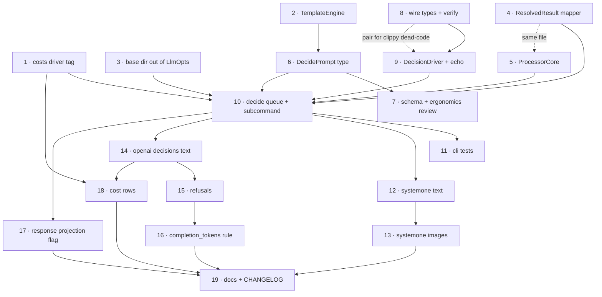

# `decide` Subcommand (Decision / System One Models)

> **Status**: Design agreed, not started. Core refactorings are being done by hand first;
> see §Work Order. Background research lives in `docs/notes/systemone-decision-api.md`
> (research-stage notes — do not edit; wire schemas are there, referenced by section below).

## Problem

Decision models (Jev/TypeSafe, llama.cpp `/v1/systemone`, OpenAI `/v1/decisions`) answer
*typed questions* rather than generating text: one forward pass, answers read from
next-token probabilities of single-token labels. They return `choice`/`score`/`bool`
answers with probabilities and a confidence value, accept `state` as string **or** JSON,
and (llama.cpp + Luna) accept images.

They are *similarly* shaped to `chat` but differ in ways that matter:

- Output carries probabilities/confidence, always.
- Schema is a 1-deep object with limited field types — not JSON Schema.
- Every enum option / bool polarity needs its own description; small models degrade
  badly without them.
- Answers are guaranteed-valid by the server; there is nothing to "retry until the
  schema validates". Partial failure (Luna `refusal`) is per-question.

## Decision: new `decide` subcommand, not a mode of `chat`

Reasons, in order of strength:

1. **"Always emit probability & confidence" cannot be expressed in `chat` without
   editing shared types.** `ChatOutput` is `{response: Option<Value>}` and
   `ChatCompletionResponse` is `{response, token_usage}`. Every workaround
   (`_confidence` keys inside `response`, new fields on `ChatCompletionResponse`,
   a side channel) permanently taxes four drivers and the published
   `schemas/ChatOutput.json` + generated bindings.
2. **The question shape is the UI.** It's more accessible than JSON Schema and has
   real traction. Hiding it behind a JSON Schema that a driver decompiles at runtime
   is the opposite of native support: users couldn't copy ecosystem examples or diff
   their config against a server's `/openapi.json`.
3. **A driver is the wrong place for prompt semantics.** A "mapping" chat driver would
   have to *invent* the question list, instructions, and option labels from a schema —
   duplicated per dialect, discovered at runtime. Question derivation belongs at
   prompt-load time, once, with `toml_span` error spans, before any rows are read.
4. Cost/script compatibility (the real argument for reuse) is delivered by
   `WorkOutput<T>` (already shared by `chat` and `ocr`) plus the `response` projection
   below — not by overloading `chat`.

Migration ramp (`ChatPrompt → DecidePrompt`) is **deferred**, one-directional only,
spec'd in §Deferred. It adds no constraints to any type, so deferring it is free.

## Output shape

`WorkOutput<DecideOutput>` — envelope (`status`/`errors`/`estimated_cost`/`token_usage`/
`passthrough_data`) is already the standard format `chat` and `ocr` emit. Data:

```jsonc
"data": {
  // OPTIONAL (`--response-projection`, commit 17): answers projected to a flat object,
  // exactly what an equivalent chat prompt's schema would have produced. External
  // scripts could then read `response` unchanged whether a job ran on a decision model
  // or a chat model. Unsettled — see commit 17.
  "response": { "category": "invoice", "urgent": true, "quality": 2.4 },

  // Rich answers, keyed by question name, canonical across dialects
  // (probabilities are ALWAYS a JSON map — never OpenAI's arrays).
  "answers": {
    "category": { "type": "choice", "choice": "invoice",
                  "confidence": 0.87,                      // server-supplied, opaque
                  "confidence_typesafe": 0.85,             // (n·p_max − 1)/(n − 1)
                  "confidence_entropy": 0.91,              // 1 − H(p)/log n
                  "probabilities": { "invoice": 0.93, "memo": 0.07 } },
    "urgent":   { "type": "bool", "value": true, "probability": 0.91 },
    "quality":  { "type": "score", "score": 2.4, "confidence": 0.60,
                  "probabilities": { "0": 0.02, "1": 0.18, "2": 0.61, "3": 0.19 } }
  }
}
```

- Always emit probabilities *and* confidence. No flag. (Decided.)
- Server confidence passes through untouched (`confidence` — formula is per-dialect and
  not portable). Both canonical formulas are computed client-side from the probability
  vector, which *is* comparable across servers.
- The flat `response` projection is **behind a CLI flag** (unsettled; isolated as commit
  17 so it is one commit to add or drop). It exists for the "route the same job to chat
  or decide across geos" case, whose documented boundary is: **flat scalar answers are
  portable, nesting/arrays are chat-only.**
- Thresholds stay in post-processing (DuckDB), never in the driver. `passthrough_data`
  carries gold labels for later Brier/ECE work.
- Flat normalized CSV (`id, question, kind, choice, score, confidence, …`) is a
  later addition; `OcrOutput::to_flat` is the precedent.

## Prompt shape (to mock up for ergonomics — see §Work Order, commits 6–7)

`read_json_or_toml` already accepts both, so ergonomics can be evaluated in JSON while
TOML stays available.

```toml
[state]                      # three modes, explicit (NOT shape-detected from row keys)
text = "..."                 # Handlebars → string
# field = "doc"              # row field passed through verbatim (typed: numbers/nesting preserved)
# "row"                      # state = "row": whole row minus id/skip_processing/passthrough_data
# json = { ... }             # structured state, templated leaves (reuse RenderTemplate for Value)

images = ["{{image-data-url image}}"]   # same syntax as chat; `images_from = "col"` too

[questions.category]
type = "choice"              # user-facing: choice | score | bool (NOT noul/predicate)
instructions = "What kind of document is this?"
[questions.category.options] # HashMap<String,String> ⇒ per-option criteria is
invoice = "A bill for goods or services..."   # structurally impossible to omit
memo    = "An internal memorandum..."

[questions.urgent]
type = "bool"
instructions = "Does this need action within 24 hours?"
true  = "..."
false = "..."
```

State mode wart to resolve: a templated leaf always renders to a **string**, so
`{{amount}}` becomes `"amount": "42"`. Proposal: when a leaf is exactly one mustache
expression, splice the binding's JSON value with its type intact (`{{to-string …}}`
forces text). Shared win — also improves chat's `assistant.json` few-shot examples.

## Factoring: share the *policies*, not the per-row work fn

| Piece | Verdict | Detail |
|---|---|---|
| `queues/work.rs`, `retry.rs`, `rate_limit.rs`, `timeouts.rs`, `mem_limit.rs`, `costs.rs`, `ui.rs`, `async_utils/io.rs`, `images.rs`, `StreamOpts` | **reuse verbatim, zero edits** | ~1600 lines. None of it mentions `ChatPrompt`. |
| `ChatOutput::from_resolved_result` (`queues/chat.rs`, ~100 ln) | **extract — best candidate** | Pure retry→record policy (Ok→ok, Fatal→failed+empty data, Recovered→ok+retry errors, GivenUp/Unrecoverable→failed). Make the work fn return `(Data, Option<TokenUsage>)` and the mapper is generic over `Data`. |
| `ProcessorState` bootstrap (`queues/chat.rs`) | **extract `ProcessorCore`** | `{ driver_kind tag, model, rate_limiter, mem_limiter, model_cost, timeout }` + `async fn new`. Embedded in each queue's own state struct (chat adds `prompt`/`validator`, decide adds `questions`/`verifier`). No generics. OCR could adopt it too. |
| Handlebars setup (`prompt.rs`: engine + escape fn + 4 helpers + `render_template` ctx, ~90 ln) | **extract `TemplateEngine::for_base_dir()`** | Both prompt types must agree on `image-data-url` semantics or they drift. Home for the leaf-type rule above. |
| `LlmOpts` (`drivers/mod.rs`) | **NOT split (for now) — extract base dir only** | The Transport/Generation split would let `decide` take `TransportOpts` and make meaningless flags unrepresentable, but it is held pending adapter-between-modes decisions and surveying other APIs in this space. Extract only the piece `decide` actually needs — `compute_canonical_base_dir` / `canonical_base_dir()` — as a free function or small struct (commit 3). Behavior, not taxonomy: keeps `decide` independent of `LlmOpts` and keeps the split reversible. |
| `run_chat` / `run_chat_inner` (~200 ln) | **do NOT genericize — write a sibling** | Chat validates a *model-authored blob* against JSON Schema (failure ⇒ **transient** retry); decide *verifies answers against the questions sent* (failure ⇒ **fatal**) plus per-question partials. A shared hook invites the two retry policies to leak into each other. |
| `cmd/chat.rs` / `cmd/ocr.rs` / `cmd/decide.rs` wiring (~60 ln × 3) | **extract *after* `decide` exists** | `run_stream_pipeline(...)` is feasible with today's `BoxedStream` types; don't design it for 1.3 real users. |
| `ChatInput` vs `DecideInput` | **duplicate (8 ln)** | Two published schema artifacts that will drift independently; aliasing couples public contracts for nothing. Keep parallel by convention + comment. |
| `costs.rs` | **small edit** | `ModelKey.driver: Option<DriverType>` parses the CSV `driver` column via `DriverType::from_str`. Make it a `String` tag + `driver_tag() -> &'static str` on each driver enum (~15 ln). Better than adding decision variants to `DriverType`, which would make `chat --driver systemone` representable (runtime 501 instead of a clap error). |

Net: ~200 lines hoisted, ~1000–1200 new (wire types ~250, two drivers ~400,
`queues/decide.rs` ~180, `DecidePrompt` ~200, CLI/echo/tests ~250).

## Driver API

One **canonical in-memory** `DecisionRequest`/`DecisionResponse` (superset, images
included); dialect modules own encode + decode. The divergences are serialization-shaped
(map vs. array questions, `bool`/`noul`/`predicate`, `files` vs. `input_image`,
probability map vs. array, answer-by-name vs. by-id), so one type is honest and keeps
verification in one place. Can't-comply cases ⇒ `DriverError::invalid_input`.

```
src/drivers/decide/mod.rs    # DecisionDriver trait, DecisionDriverType, Limits, echo
src/drivers/decide/systemone.rs      # llama.cpp + Jev core + OpenJev-compatible
src/drivers/decide/openai_decisions.rs  # /v1/decisions (Luna)
src/drivers/decide/echo.rs           # credential-free integration tests
```

- Keep `state`/`questions` core wire-clean of image fields (note's dialect advice);
  images attach per dialect, or error on text-only Jev. We can skip llama.cpp's
  chat-message `image_url` state form entirely — a small win of not making `state`
  chat-shaped.
- **Per-model caps** (52 options on openjev vs. 255 nominal; score 2–10 vs. 2–64) come
  from a `Limits` struct resolved at driver construction — never hardcoded in the prompt
  type. `GET /v1/limits` auto-negotiation is *not* being done (§Deferred).
- Forward-compat serde: keep unknown request/answer fields intact (kunobi's
  `extra()`/`Answer::Unknown`), catch-all for unknown answer variants (beta API).
- `verify_answers(&questions, &answers)` in the decide work fn: missing ids, kind
  mismatch, choice ∉ offered options ⇒ `invalid_output` **fatal** (server bug; retrying
  sends the same request to the same broken endpoint). Luna `refusal` ⇒ first-class
  per-question outcome carried in `answers[q]`, never a record-level status (see
  §Landmines).
- Router mode: `--model` maps to the per-request `model` field. N questions per request
  (native + cheap); **one row per request** — no multi-state batch endpoint exists, and
  packing N rows into one `state` cross-contaminates on small models. Document "never
  pack rows".
- Token accounting: these models generate **one token per answer**, even where they don't
  bill for it. So `completion_tokens` = number of answers generated (refusals included),
  computed by us rather than taken from the response — which makes OpenJev's
  `output_tokens = question count` *correct* and llama.cpp's `0` the omission. Log any
  discrepancy at `debug!`. Harmless for cost either way today (decision models carry zero
  output price) and correct for any that ever bill output. Refused records still bill on
  Luna — keep their `token_usage`.

## Landmines / open decisions

1. **MemLimiter multi-image deadlock.** `cmd/chat.rs` passes `MemLimiter::unlimited()`
   with a TODO to pre-acquire permits for all images in a request. Vision `decide` at
   high `--jobs` over PDF pages is precisely that workload. Fix properly, or inherit the
   workaround?
2. **Image placement isn't ours to control.** llama.cpp puts `files` *before* the state;
   chat lets authors position images with `image-data-url`. With `images` as a sibling of
   `state`, placement becomes dialect-determined. Accept + document, or add
   `image_placement = "before" | "after"`?

Non-issue, so it doesn't get re-raised: `WorkStatus::Incomplete` is an artifact of
multi-request-per-item work (page-level recovery in OCR) and **cannot arise** on a
one-request-per-item path like `decide`. Per-question refusals live inside `answers[q]`
with the record staying `ok`, so `--allowed-failure-rate` semantics are untouched.

## Deferred (named, so it stays cheap)

- **`ChatPrompt → DecidePrompt` ramp**: `decide --chat-prompt legacy.toml` and/or
  `prompt-scaler convert-prompt`. One direction only (`DecidePrompt → ChatPrompt` is
  trivial but loses probabilities, so nobody needs it). It **cannot invent criteria
  text** — substitute a placeholder and refuse by default (`--allow-placeholder-criteria`
  to override), because silent small-model quality regression is the worst failure mode
  available. Checkable via the `response` projection.
- `cmd` pipeline extraction; flat CSV answer export; umbrella `run` dispatching on prompt
  shape (only ever *after* two clean subcommands — it makes the output record type
  conditional).
- Preflight (`/v1/limits`, `output_modalities: ["decisions"]`) — skipped: less
  standardized than the core. Just surface 400/501 messages well.
- Per-answer confidence *gates* (judgment's `.at_least()` style) — post-processing.
- Pi's chat-model classification emulation — out of scope per the research note.
- PDF rasterization inside `decide`: compose `ocr` → `decide` on the JSONL for now.

## Work Order

Dependency graph (solid = must land first; dotted = same-file conflict or CI pairing,
not a semantic dependency). Anything not joined by a path can be reordered freely.



**Checkpoints:** after **10** the feature is usable and CI-covered with no credentials;
after **12** there is a real llama.cpp path to eval against (`localhost:8080`) — validate
there before adding images in 13, so a bisect can't confuse pipeline bug with wire bug.

**Two ordering principles.** (1) *The unstable artifact goes early, where it has no
consumers:* the prompt format is what most likely churns (it needs human ergonomics
review), so it lands at 6–7 when only `schema` output depends on it — not after a queue,
two drivers and fixtures consume it. (2) *Echo before network:* prove canonical types →
queue → JSONL offline, so each later transport diffs as a pure wire adapter.

### Phase 0 — prepare the ground (pure moves; existing `chat`/`ocr` tests pass unchanged)

| # | Commit | Depends | Justification |
|---|---|---|---|
| 1 | `costs: key model costs by driver tag, not DriverType` | — | Removes the last coupling that would force decision drivers into the chat driver enum. ~15 ln, unblocks everything. |
| 2 | `prompt: extract TemplateEngine::for_base_dir()` | — | Engine + escape fn + 3 helpers must be *one* definition shared by both prompt types, or image semantics drift. Pure move. |
| 3 | `prompt: resolve base dir outside LlmOpts` | — | The only `LlmOpts` behavior a second subcommand needs. Extracts behavior, not taxonomy — keeps the Transport/Generation split reversible. |
| 4 | `queues: generalize ResolvedResult → WorkOutput mapping` | — | Single home for retry→record policy (Ok/Fatal/Recovered/GivenUp). Decisions get identical retry reporting for free. |
| 5 | `queues: extract ProcessorCore` | (4, same file) | Driver construction + cost lookup + rate limiter + timeout as shared bootstrap, no generics. Land before the decide queue exists so 10 writes against it on day one. |

### Phase 1 — unstable artifacts first

| # | Commit | Depends | Justification |
|---|---|---|---|
| 6 | `prompt: add DecidePrompt type (not yet wired)` | 2 | State modes + questions + images. Lands where only `schema` consumes it, so ergonomics feedback is cheap. Needs `#[expect(dead_code, reason = "unwired")]` (pattern at `costs.rs:71`) — CI is `clippy -D warnings`. |
| 7 | `schema: expose DecidePrompt/DecideInput/DecideOutput` | 6 | `SchemaType` variants + `schemas/*.json` + the model loop in the `Justfile` (`update-pydantic-models`). **Mock up 3–4 prompts here (JSON) and judge ergonomics** — whole-row JSON state, image + state, score, bool with polarities. Expect a follow-up fix commit; that's the point of placing it this early. |
| 8 | `drivers: canonical decision request/response + answer verification` | (9, CI) | The contract both sides write against, locked before two subsystems diverge. `verify_answers` unit-tested standalone. Pair with 9 (or use `#[expect]`) for dead code. |

### Phase 2 — offline end-to-end

| # | Commit | Depends | Justification |
|---|---|---|---|
| 9 | `drivers: decision driver trait + echo implementation` | 8 | `DecisionDriver`, `DecisionDriverType`, per-driver `Limits`. Echo gives a credential-free path the moment the queue lands. |
| 10 | `queues: decide work queue + decide subcommand` | 1,3,4,5,6,9 | State assembly → request → verify → `DecideOutput`. First user-visible `decide`, fully testable offline. **Checkpoint.** |
| 11 | `tests: cli coverage for decide (echo)` | 10 | Happy path, verify-failure ⇒ fatal, skip/passthrough, multi-question. Mirrors `test_chat_echo_driver`. |

### Phase 3 — transports, one variable at a time

| # | Commit | Depends | Justification |
|---|---|---|---|
| 12 | `drivers: systemone transport (text-only)` | 10 | Self-hosted, free, locally reproducible: validate the core wire before adding the image dimension. **Checkpoint** for a real llama.cpp eval run. |
| 13 | `drivers: systemone image support (files/data URLs)` | 12 | Separate because images are the unstandardized axis (3 incompatible shapes) and where `MemLimiter` multi-image acquisition bites (landmine 1). Core type stays image-free. |
| 14 | `drivers: openai decisions transport (Luna)` | 10 | Second dialect, text-only first; exercises the canonical type's claim of dialect-neutrality. |
| 15 | `drivers: handle per-question refusals as first-class outcomes` | 14 | Its own commit because it's a *semantic* addition (partial answers; refused records still bill), not a transport detail. |
| 16 | `drivers: normalize completion_tokens to answers generated` | 15 (both dialects) | Small accounting rule with its own reasoning, testable in isolation. |

### Phase 4 — surface & cleanup

| # | Commit | Depends | Justification |
|---|---|---|---|
| 17 | `decide: optional chat-shaped response projection (flagged)` | 10 | Deliberately late and isolated: least-settled decision, so removal is one commit. |
| 18 | `costs: pricing rows for decision models` | 1,14 | Luna is input-only pricing; local models need no row (unknown ⇒ no estimate, which is honest). |
| 19 | `docs + CHANGELOG` | 13,16,17,18 | After the CLI surface settles. |

Optional later: `cmd: extract shared stream pipeline harness` (three real users exist);
flat CSV answer export; the `ChatPrompt → DecidePrompt` ramp (§Deferred).

### Orderings considered and rejected

- **Vertical slice first** (llama.cpp `decide` working, refactor after). Better when the
  *internal* shape is what's uncertain; here it's settled and the *external* wire is what
  is uncertain — and Phase 0 is cheap pure moves, so deferring them costs writing the
  retry→record policy twice and re-reviewing chat regressions twice. If earlier llama.cpp
  signal matters: land 1–4, jump to 12, then 6–10.
- **Drivers before prompt type.** Rejected: prompt churn dominates expected cost, and
  drivers consume the canonical wire types, not the prompt type — nothing gained.
- **Dialects bundled with the queue.** Rejected: bundles a new CLI surface with two
  unproven transports, so a bisect can't separate pipeline bug from wire bug.
- **Extractions interleaved into feature commits.** Rejected as a rule: breaks the
  "pure move ⇒ existing tests are the proof" property that makes refactors cheap.
  Exception already made: 8+9 pairing, forced by `clippy -D warnings` on dead code.

## Testing notes

- `cargo check` → `cargo test` after each step; `cargo test -- --include-ignored` for
  live-model tests only on request; `just check` before committing.
- Offline coverage rides the echo driver pattern (`test_chat_echo_driver` in
  `tests/cli.rs`), so `decide` needs its own echo driver before integration tests.
- Live llama.cpp examples/configs say `localhost:8080` in anything committed — hostnames
  for this machine's local infrastructure stay out of the repo.
- `RUST_LOG=prompt_scaler=debug,warn` when debugging a run.
