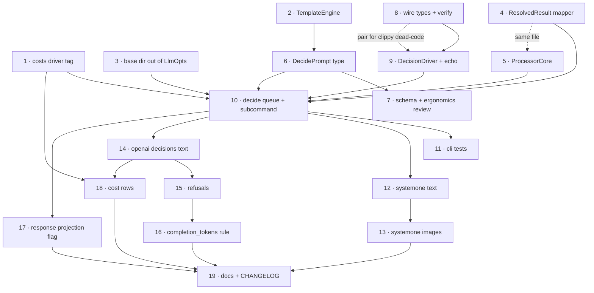

# `decide` Subcommand (Decision / System One Models)

> **Status**: Design agreed. Groundwork (Phase 0), the decision data types, the
> `DecideDriver` trait, the **SystemOne transport (validated against a live llama.cpp
> with Kev-4B)**, `DecideDriverType`, `verify_answers`, and — with items 20 + 10 —
> **the queue and the `decide` subcommand are landed**: `prompt-scaler decide -p
> prompt.json -m MODEL < in.jsonl > out.jsonl` works end to end against a local
> llama.cpp, and `tests/cli.rs` has a live happy-path test plus three
> server-free ones. As of `2c90094` the feature is *done for its first release*: what
> remains is tests, docs and one open prompt-shape question (§Remaining scope).
> **Re-scoped 2026-10-20** with the user: Luna (14) and everything hanging off it
> (refusals 15, Luna-side 16), the `response` projection (17), decision-model cost rows
> (18), SystemOne images (13) and published schema artifacts (22) are **deferred, none of
> them release blockers**. Echo is **dropped, not postponed**: echo exists for `chat`
> because chat output is freeform; `decide`'s output is a typed structure already checked
> against the questions sent, so an echo driver would exercise almost nothing (§Testing).
> **NEXT STEP: 7b** (`{{amount}}` → `"42"` leaf-type splice). Item 26a — the no-plumbing unit
> tests — **landed** (15 tests), and so did 19a: user docs now live in `docs/decide.md`, with
> README hooks for the subcommand and its two environment variables. The CHANGELOG stays with
> the release process (19b).
> Where this section and the original draft disagree, §Progress wins. Background research
> lives in `docs/notes/systemone-decision-api.md` (research-stage notes — do not edit; wire
> schemas are there, referenced by section below).

## Remaining scope

Re-scoped 2026-10-20. `decide` is usable and correct for text-only SystemOne/llama.cpp
(`cargo test`: 13 passed / 18 ignored; `decide` contributes one `#[ignore]`d live test and
three server-free ones). Only the first three rows stand between here and a release.

| Priority | Item | What |
|---|---|---|
| ✅ done | **26a** | **Unit tests that needed no scaffolding — landed** (15 tests, `cargo test --bins` 65 passed): `Question::validate` (empty instructions, one-option choice, score 2–10 incl. boundaries); `assemble_state` (record `state` verbatim — template syntax untouched — and prompt `state` not reprocessed); `DecidePrompt::render` (substitution at any depth in nested `state`, **questions are never templated**, `images` render); `WorkInput<DecideInput>` deserialization (envelope keys and `state` never become bindings; absent `state` is `None`, not `Null`); `DriverError` transience; `StatusCode::is_known_transient` incl. 529 and the "unproven ⇒ fatal" default. Dropped from the original list as tautological or mis-homed: `impl WorkResponse for DecideResponse` (three lines of pass-through), `from_resolved_result`'s arms (shared — item 27), `token_usage`/cost propagation (same). |
| Optional | **26b** | Tests that need a `#[derive(Default)]` or `#[cfg(test)]` ctor on `DecideDriverOpts`/`DriverOpts` (clap `Args`, no `Default` today; `LlmOpts` has none either, so it's new surface): **C1** verify-failure ⇒ `Fatal` with *exactly one* driver call — the only test that proves `try_fatal!` guards `verify_answers`, which A-level tests can't; **C2** `skip_processing` returns `Skipped` *before* prompt rendering (feed a poisoned prompt); **C3** `--decide-timeout` yields a transient error. Needs a stub `DecideDriver` in the test module. |
| Optional | **27** | `WorkOutput::from_resolved_result`'s five arms (`Ok`/`Fatal`/`Recovered`/`GivenUp`/`Unrecoverable`), untested since before `decide` existed. Shared with `chat`/`ocr`, so test **once in `src/queues/work.rs`** against a local mock `WorkResponse` — don't bill it to `decide`. |
| ✅ done | **19a** | **User docs — landed.** `docs/decide.md` covers the subcommand in Simple Technical English: what a decision model is, quick start, endpoint + credentials (`SYSTEM_ONE_API_URL`, `SYSTEM_ONE_API_KEY`, `.env`, llama.cpp invocation), the JSON prompt and the three question kinds, the two-source `state` rule and its verbatim/template split, input fields, output fields (incl. `noul`, opaque `confidence`, `completion_tokens` = answer count, no estimate for local models), error handling and the retryable status set, useful options, what's *not* supported (images, TOML, other drivers), and `schema DecidePrompt`/`DecideInput`/`DecideOutput` for reference. README gained an env-var section, a pointer under Documentation, and a short "Decision Models" section next to OCR. Fixed the `DEFAULT_BASE_URL` doc comment (said `127.0.0.1`). `CHANGELOG.md` stays with the release process (`docs/tasks/release.md`), item 19b. |
| **Review owed** | **7b** | The leaf-type splice: a templated `state` leaf always renders to a **string**, so `{{amount}}` becomes `"42"`. Everything else about the prompt shape was reviewed and is fine. Splicing the binding's JSON value when a leaf is exactly one mustache may be genuinely hard inside the shared Handlebars layer (`RenderTemplate for Value` is shared with `chat`'s `assistant.json` few-shots, so a fix is a shared win and a shared risk). Look before it hardens into a compatibility burden; not a release blocker. |
| **Medium-term TODO** | **13** | SystemOne images: `file:` → base64 loading (`ImageFile::from_url(..).load(Base64, mem_limiter)`), dialect placement (`files` vs an `images` alias), and the `MemLimiter` multi-image question (landmine 1). **Interim hazard while deferred:** `run_decide` already forwards rendered `prompt.images` into `DecideRequest.images` and `SystemOneDriver` serializes them verbatim, but `image-data-url` emits a `file:` URL meaning *load me later* — so an image prompt today gets plausible-looking garbage, not an error. Either reject non-`data:` URLs loudly in the driver or keep images undocumented until 13 lands. |
| **Deferred** | 14, 15, 16b, 17, 18 | Luna `/v1/decisions` and its dependencies: per-question `refusal` (moot on its own merits — see §Landmines), Luna-side `completion_tokens`, the `--response-projection` flag, decision-model cost rows. All additive; nothing in the canonical types has to change to admit them later (§Deferred). |
| **Won't do** | 22 | `schemas/Decide*.json` and the two `Justfile` model loops stay as they are. `cargo run -- schema DecidePrompt` (likewise `DecideInput`, `DecideOutput`) already emits them on demand. |
| **Dropped** | echo (was part of 9, then 25) | No `decide` echo driver will be written; see §Testing. |

## Progress

What exists in the tree (groundwork row baseline: `ff14cfc`), with the names as implemented:

| What | Where | Notes |
|---|---|---|
| Chat prompt/driver split, type-state prompts | `src/prompts/{mod,chat}.rs`, `src/drivers/llm/`, `src/drivers/ocr/` | `PromptState`/`Template`/`Rendered`; OCR engines moved under `drivers/`. |
| `DecidePrompt` | `src/prompts/decide.rs` | `state: Option<Value>` + `images` + `questions`; questions are not templated. **JSON-only**: no `toml_span::Deserialize` impl (item 21 stays deferred), so `cmd_decide` loads it with the new `async_utils::io::read_json` — `read_json_or_toml` cannot be used, because its `T: toml_span::Deserialize<'static>` bound rejects the type outright. |
| Canonical decision types | `src/drivers/decide/mod.rs` | `DecideRequest` is wire-shaped (consensus /v1/systemone); `DecideResponse` is **canonical, not wire**: carries `token_usage: Option<TokenUsage>`, with the wire `Usage` driver-internal. `Question`/`Answer`. Fields are `pub` (item 20 landed inside 10), so the queue builds requests and reads answers directly. |
| `DecideDriver` trait + `DecideDriverType` | `src/drivers/decide/mod.rs` | `decide()` → `Result<DecideResponse, DriverError>`; model rides inside the request. `DecideDriverType` (`SystemOne` default, `Display`/`ValueEnum`, `create_driver()`) feeds `DriverType::Decide(…)` and is selected by `--driver`. No echo driver at all — echo was a `chat`-only affordance (§Testing); `Limits` deferred (§Driver API). |
| `DecideDriverOpts` | `src/drivers/decide/mod.rs` | The `decide` analog of `LlmOpts`, deliberately small: `--driver`, `--decide-timeout`, flattened `DriverOpts`, plus `decide_timeout_duration()`. Naming: `DecideDriverOpts`, not `DecideOpts`, because the subcommand's own clap struct is `cmd::decide::DecideOpts` (chat has the same split: `ChatOpts` + `LlmOpts`). `--driver`/`--model` are unprefixed (conceptually special); other decide flags take a `--decide-` prefix, leaving room for fallback drivers later. |
| `SystemOne` driver | `src/drivers/decide/system_one.rs` | llama.cpp/Jev transport over `reqwest`; driver-internal `SystemOneResponse`/`Usage`; usage normalization incl. the discrepancy `debug!` (item 16's rule, implemented early by agreement). Offline wire-format test passes; live `#[ignore]`d test `test_system_one_live_kev` **passed** against Kev-4B (all three question kinds, legend, probability sums, model echo, `prompt_tokens: 278` + normalized `completion_tokens`). Default server URL is `http://localhost:8080` (`DEFAULT_BASE_URL`); `SYSTEM_ONE_API_URL` overrides. The draft's IPv4-literal advice was dropped — it isn't worth an ugly default. The module doc comment still says `127.0.0.1` (§Remaining scope). |
| Queue + subcommand | `src/queues/decide.rs`, `src/cmd/decide.rs`, `src/main.rs` | `DecideInput` (verbatim `state` + flattened bindings), `DecideOutput{answers: Option<BTreeMap<String, Answer>>}` (now `Default`), `impl WorkResponse for DecideResponse`, `process_decide_stream` / `create_decide_work_queue` / `run_decide` / `run_decide_inner` on `CommonProcessorState`, `DecideStreamInfo`, `cmd_decide`, `Cmd::Decide`. Prepare failures abort the batch (item 23). `SchemaType` variants wired; `schemas/*.json` + `Justfile` loops deliberately skipped (item 22 closed as won't-do). |
| Retry→record policy | `WorkOutput::from_resolved_result` (`src/queues/work.rs`) | Generic over a **`WorkResponse` trait**, not over a `(Data, Option<TokenUsage>)` tuple. See §Factoring. |
| Shared processor state | `CommonProcessorState` (`src/queues/processor_state.rs`) | `{rate_limiter, mem_limiter, model_cost}` + `wait_on_rate_limiter()`. No ctor, no `model`/`timeout`/`base_dir`/driver tag. Smaller than the draft's `ProcessorCore` — on purpose. |
| Cost lookup keyed by driver | `ModelKey.driver: Option<DriverType>` (`src/costs.rs`) | `DriverType` is a small shared enum in `drivers/mod.rs` (`Llm(LlmDriverType)`, later `Decide(…)`), parsed with `FromStr` so bad names still error and matching stays case-insensitive; `Display` on `LlmDriverType` supplies the tag. **Not** the draft's `String` tags — same effect, less exposure. |
| Bootstrap behaviour | `DriverOpts::cost_info(DriverType, model)`, `DriverOpts::rate_limiter()` | Where the draft imagined `ProcessorCore::new`, the behaviour went next to the data it reads. |

Naming: **`Decide*` everywhere** — `drivers/decide`, `queues/decide.rs`,
`DecideInput`/`DecideOutput`/`DecidePrompt`, schema titles `DecideInput`/…. So the trait is
`DecideDriver`/`DecideDriverType`, not `DecisionDriver`. Dialect driver types keep
ecosystem spelling: `SystemOne` (file `system_one.rs`), with a driver-internal
`SystemOneResponse` for the wire shape.

**Ordering (revised):** per the §Work Order escape hatch ("if earlier llama.cpp signal
matters: land 1–4, jump to 12"), the `SystemOne` driver came **first**: text-only
`drivers/decide/system_one.rs` against a local llama.cpp, validated by `#[ignore]`d unit
tests inside the driver module (item 20's private fields didn't block a child module, and
in-crate tests sidestep them too). Then 8 (`verify_answers`) → 10 + 20 (queue/CLI
checkpoint), with `pub` visibility landing in the queue commit as planned. Echo never
landed and is now **dropped** (item 25 closed): echo was a `chat`-only affordance, so the
offline story is unit tests instead (item 26, §Testing policy). Today the queue's coverage
is the live `#[ignore]`d test plus three server-free prepare-failure tests, and its
*decision logic* is untested in CI. 21 stays deferred (JSON-only prompts, now via
`read_json`); 22 is closed as won't-do.

## Problem

Decision models (Jev/TypeSafe, llama.cpp `/v1/systemone`, OpenAI `/v1/decisions`) answer
*typed questions* rather than generating text: one forward pass, answers read from
next-token probabilities of single-token labels. They return `choice`/`score`/`bool`
answers with probabilities and a confidence value, accept `state` as string **or** JSON,
and (llama.cpp + Luna) accept images.

They are *similarly* shaped to `chat` but differ in ways that matter:

- Output carries probabilities/confidence, always.
- Schema is a 1-deep object with limited field types — not JSON Schema.
- Every enum option / bool polarity needs its own description; small models degrade
  badly without them.
- Answers are guaranteed-valid by the server; there is nothing to "retry until the
  schema validates". A dialect *may* decline to answer (Luna's per-question `refusal`);
  nothing in our design treats that as a special state — it's an error like any other
  (§Landmines 3).

## Decision: new `decide` subcommand, not a mode of `chat`

Reasons, in order of strength:

1. **"Always emit probability & confidence" cannot be expressed in `chat` without
   editing shared types.** `ChatOutput` is `{response: Option<Value>}` and
   `ChatCompletionResponse` is `{response, token_usage}`. Every workaround
   (`_confidence` keys inside `response`, new fields on `ChatCompletionResponse`,
   a side channel) permanently taxes four drivers and the published
   `schemas/ChatOutput.json` + generated bindings.
2. **The question shape is the UI.** It's more accessible than JSON Schema and has
   real traction. Hiding it behind a JSON Schema that a driver decompiles at runtime
   is the opposite of native support: users couldn't copy ecosystem examples or diff
   their config against a server's `/openapi.json`.
3. **A driver is the wrong place for prompt semantics.** A "mapping" chat driver would
   have to *invent* the question list, instructions, and option labels from a schema —
   duplicated per dialect, discovered at runtime. Question derivation belongs at
   prompt-load time, once, with `toml_span` error spans, before any rows are read.
4. Cost/script compatibility (the real argument for reuse) is delivered by
   `WorkOutput<T>` (already shared by `chat` and `ocr`) — not by overloading `chat`. (The
   `response` projection that used to be cited here as part of that argument is postponed;
   the envelope alone carries the cost/script compatibility case, and it still holds.)

Migration ramp (`ChatPrompt → DecidePrompt`) is **deferred**, one-directional only,
spec'd in §Deferred. It adds no constraints to any type, so deferring it is free.

## Output shape

`WorkOutput<DecideOutput>` — envelope (`status`/`errors`/`estimated_cost`/`token_usage`/
`passthrough_data`) is already the standard format `chat` and `ocr` emit. Data:

```jsonc
"data": {
  // NOT IMPLEMENTED — postponed to a later version (item 17, deferred). Would project
  // answers to a flat object, exactly what an equivalent chat prompt's schema would have
  // produced, so external scripts could read `response` unchanged whether a job ran on a
  // decision model or a chat model.
  // "response": { "category": "invoice", "urgent": true, "quality": 2.4 },

  // Rich answers, keyed by question name, canonical across dialects
  // (probabilities are ALWAYS a JSON map — never OpenAI's arrays).
  "answers": {
    "category": { "type": "choice", "choice": "invoice",
                  "confidence": 0.87,                      // server-supplied, opaque
                  "confidence_typesafe": 0.85,             // (n·p_max − 1)/(n − 1)
                  "confidence_entropy": 0.91,              // 1 − H(p)/log n
                  "probabilities": { "invoice": 0.93, "memo": 0.07 } },
    "urgent":   { "type": "bool", "value": true, "probability": 0.91 },
    "quality":  { "type": "score", "score": 2.4, "confidence": 0.60,
                  "probabilities": { "0": 0.02, "1": 0.18, "2": 0.61, "3": 0.19 } }
  }
}
```

- Always emit probabilities *and* confidence. No flag. (Decided.)
- Server confidence passes through untouched (`confidence` — formula is per-dialect and
  not portable). Both canonical formulas are computed client-side from the probability
  vector, which *is* comparable across servers.
- The flat `response` projection is **postponed to a later version** (item 17): it was
  always the least-settled decision, and with Luna deferred there is no near-term driver
  for the "route the same job to chat or decide across geos" case it existed for. When it
  comes back it goes **behind a CLI flag**, and `answers` being keyed by question name
  keeps it mechanical. Its boundary, if revived: **flat scalar answers are portable,
  nesting/arrays are chat-only.**
- Thresholds stay in post-processing (DuckDB), never in the driver. `passthrough_data`
  carries gold labels for later Brier/ECE work.
- Flat normalized CSV (`id, question, kind, choice, score, confidence, …`) is a
  later addition; `OcrOutput::to_flat` is the precedent.
- **As implemented** (`src/queues/decide.rs`): `answers` is `Option<BTreeMap<String,
  Answer>>`, keyed by question name, so the projection and flat-CSV export both remain
  possible, and `DecideOutput` derives `Default` because `WorkOutput::from_resolved_result`
  builds failure data from `Output: Default`. Its element type is `drivers::decide::Answer`
  — the *wire* type — which carries only server-supplied `confidence`, has no `refusal`
  variant, and emits `noul` rather than `bool`. **Item 24 is settled and implemented**: that
  is the intended shape, so the two client-computed formulas (`confidence_typesafe`/
  `confidence_entropy`) have no home and stay out; if they ever come back they belong in the
  §Deferred post-processing bucket, not in `Answer`. The server-resolved response `model` is
  dropped on the way to `DecideOutput`, as in `chat`.

## Prompt shape (to mock up for ergonomics — see §Work Order, commits 6–7)

**JSON only, initially** (decided): `decide` will not support TOML prompts at first, so
item 21 is deferred and the shape below is judged as JSON. Rationale: the JSON question
format is simpler and becoming better-known than full-on `chat` + `json_schema`, so the
prompt doubles as a near-copy of ecosystem examples; `toml_span`'s diagnostics are also
exactly what JSON error reporting lacks, which item 21 would have to rebuild anyway.

**Correction to the draft:** `read_json_or_toml` does *not* "already accept both" for us —
it is bound on `T: DeserializeOwned + toml_span::Deserialize<'static>`, which `DecidePrompt`
does not satisfy, so `read_json_or_toml::<DecidePrompt>` fails to **compile** rather than
failing gracefully on a `.toml` file. Item 10 therefore added `async_utils::io::read_json<T>`
(next to `read_json_or_toml_as_json_value`, with the shared "open + slurp" step factored out)
and `cmd_decide` calls it: a `.toml` decide prompt now gets a plain "TOML is not supported
here" error, which is the behavior item 21 asked for without implementing the toml_span impl.
Covered by `test_decide_rejects_toml_prompt`.

```toml
[state]                      # three modes, explicit (NOT shape-detected from row keys)
text = "..."                 # Handlebars → string
# field = "doc"              # row field passed through verbatim (typed: numbers/nesting preserved)
# "row"                      # state = "row": whole row minus id/skip_processing/passthrough_data
# json = { ... }             # structured state, templated leaves (reuse RenderTemplate for Value)

images = ["{{image-data-url image}}"]   # same syntax as chat; `images_from = "col"` too

[questions.category]
type = "choice"              # user-facing: choice | score | bool (NOT noul/predicate)
instructions = "What kind of document is this?"
[questions.category.options] # HashMap<String,String> ⇒ per-option criteria is
invoice = "A bill for goods or services..."   # structurally impossible to omit
memo    = "An internal memorandum..."

[questions.urgent]
type = "bool"
instructions = "Does this need action within 24 hours?"
true  = "..."
false = "..."
```

State mode wart — **item 7b, the one prompt-shape question still open**: a templated leaf
always renders to a **string**, so `{{amount}}` becomes `"amount": "42"`. Proposal: when a
leaf is exactly one mustache expression, splice the binding's JSON value with its type
intact (`{{to-string …}}` forces text). Shared win — it also improves chat's
`assistant.json` few-shot examples — and shared risk: `RenderTemplate for Value` lives in
the general templating framework, so fixing it there may be hard without changing `chat`
rendering. Review as 7b; the rest of the prompt shape was reviewed and is fine.

**As implemented** (`src/prompts/decide.rs`) this is *not* the shape above yet, and the mode
table above is **superseded**: `state` is one `Option<Value>`, and there are exactly **two
mutually exclusive ways to supply it** — zero or two sources is an error that stops the whole
run (`queues::decide::assemble_state`). That is all the mode table was really for:

| Mode | Source | Treatment |
|---|---|---|
| **a** | `state` field on the **input record** | sent **verbatim**, no template substitution |
| **b** | `state` in the **prompt** | rendered with the record's bindings (`RenderTemplate for Value`: string leaves only, so the leaf-type splice wart above is still open — item 7b) |

Custom (flattened) fields are template bindings: in mode b they fill `state` (and `images`),
in mode a only `images`. Bindings are never themselves the state, and unused bindings are not
an error. That was on the table for a moment — "if neither side declares state, use the
bindings object" — and was rejected: implicit state is the kind of magic that costs a reader
twenty minutes six months out. If a richer mode table (`field = "doc"`, an explicit
`state = "row"`) is ever wanted, it becomes a *new* prompt field rather than loosening this rule.

The rest of the trade stands: `questions` is
`BTreeMap<String, drivers::decide::Question>` — prompt type and wire type are the **same**
type, which means the user-facing keyword is `noul`, not `bool`. That trade is now
deliberate (one type, one validation path, prompts read like server payloads and like
ecosystem examples) and has two consequences to keep watching: per-model caps can't live in
`Question` (caps are deferred — see §Driver API), and a dialect that
can't carry criteria (OpenAI `predicate` has no criteria field) must fail loudly rather than
silently drop them — silent small-model regression is still the worst failure mode here.

**Images** (item 13) are a `Vec<String>` of templates rendered with the record's
bindings through the same `templates::TemplateEngine` that `chat` uses, so `image-data-url`
and friends behave identically; the queue renders them and forwards them into
`DecideRequest.images`, treating an empty list as "no images" so text-only requests stay
wire-exact. Item 13 is a **medium-term TODO, not a release blocker**. What it still owes is
the `file:` → base64 conversion that chat drivers do themselves
(`ImageFile::from_url(..).load(Base64, mem_limiter)`) plus dialect placement (`files` vs an
`images` alias): `image-data-url` emits a `file:` URL for *late* loading rather than a data
URL, so forwarding is not the same as supporting them. Until 13 lands the wiring is ahead of
the capability: an image-bearing prompt sends the literal `file:/…` string and gets back
plausible answers rather than an error. `MemLimiter::unlimited()` is inherited from `chat`
meanwhile (landmine 1), harmless only because nothing loads image bytes yet.

## Factoring: share the *policies*, not the per-row work fn

| Piece | Verdict | Detail |
|---|---|---|
| `queues/work.rs`, `retry.rs`, `rate_limit.rs`, `timeouts.rs`, `mem_limit.rs`, `costs.rs`, `ui.rs`, `async_utils/io.rs`, `images.rs`, `StreamOpts` | **reuse verbatim, zero edits** | ~1600 lines. None of it mentions `ChatPrompt`. |
| `ChatOutput::from_resolved_result` (`queues/chat.rs`) | **DONE — `WorkOutput::from_resolved_result` + `WorkResponse` trait** (`work.rs`) | Generic over `Response: WorkResponse<Output = T>`; the trait supplies `to_output(self) -> Output` and `token_usage(&self) -> Option<&TokenUsage>`, and failure data comes from `Output: Default` (chat's `empty_for_error()` is gone). Arm semantics preserved, incl. `format!("{err:?}")` and errors ordered retry-then-fatal. Two consequences worth knowing: (a) `to_output` consumes `self` so the payload moves rather than cloning; (b) `token_usage()` returning `Option<&TokenUsage>` **forces** `Usage → TokenUsage` normalization into drivers, which is what the three usage dialects need. Arms remain untested (pre-existing gap). |
| `ProcessorState` bootstrap (`queues/chat.rs`) | **DONE — `CommonProcessorState`** (`queues/processor_state.rs`) | Implemented as `{rate_limiter, mem_limiter, model_cost}` + `wait_on_rate_limiter()`: no ctor, no `model`/`timeout`/`base_dir`/driver tag. Cost lookup + rate-limiter construction became `DriverOpts` methods, since that's where their inputs live. `ChatProcessorState` = `common` + `driver` + `model` + `prompt` + `schema` + `validator` + `llm_opts`; `run_chat` still reaches `llm_opts` for base dir and timeout, so **decide carries its own opts struct for those two values** (accepted, see §Refactorings considered and declined). |
| Handlebars setup (engine + escape fn + helpers + `render_template` ctx) | **DONE — `templates::TemplateEngine`** | One definition, both prompt types use it, so `image-data-url` semantics can't drift. Still built per rendered row; that's pre-existing and cheap next to network latency (see §Refactorings considered and declined). The leaf-type rule above is still unimplemented. |
| `LlmOpts` (`drivers/mod.rs`) | **NOT split (for now) — extract base dir only** | The Transport/Generation split would let `decide` take `TransportOpts` and make meaningless flags unrepresentable, but it is held pending adapter-between-modes decisions and surveying other APIs in this space. Extract only the piece `decide` actually needs — `compute_canonical_base_dir` / `canonical_base_dir()` — as a free function or small struct (commit 3). Behavior, not taxonomy: keeps `decide` independent of `LlmOpts` and keeps the split reversible. |
| `run_chat` / `run_chat_inner` (~200 ln) | **do NOT genericize — write a sibling** | Chat validates a *model-authored blob* against JSON Schema (failure ⇒ **transient** retry); decide *verifies answers against the questions sent* (failure ⇒ **fatal**) plus per-question partials. A shared hook invites the two retry policies to leak into each other. |
| `cmd/chat.rs` / `cmd/ocr.rs` / `cmd/decide.rs` wiring (~60 ln × 3) | **extract *after* `decide` exists** — it now does; still declined | Three real users exist, so `run_stream_pipeline(...)` is finally designable, but it is still a refactor of ~60-line files that all work. Left alone: `decide` copied `chat`'s shape verbatim, so extraction is now a mechanical diff-able move whenever someone wants it. See §Deferred. |
| `ChatInput` vs `DecideInput` | **duplicate (8 ln)** | Two published schema artifacts that will drift independently; aliasing couples public contracts for nothing. Keep parallel by convention + comment. |
| `costs.rs` | **DONE — shared `DriverType` enum, not `String` tags** | `ModelKey.driver: Option<DriverType>`, where `DriverType` (`drivers/mod.rs`) wraps `LlmDriverType` and now also `Decide(DecideDriverType)`. The CSV `driver` column is parsed with `DriverType::from_str`, so unknown names still error at load and matching stays case-insensitive. Keeps the draft's goal (decision drivers never enter the *chat* driver enum) while avoiding a bare string that silently never matches. |
| `WorkOutput::new_failed` | **open, but blocks nothing today** | `token_usage`/`estimated_cost` are hardcoded to `None`, so every `GivenUp` in `chat` and `decide` under-bills. Pre-existing, inherited behaviour; the only thing that made it urgent was Luna billing refused records (items 14/15, now deferred). Revisit when a driver that actually bills failed requests is on the table. |
| Prepare-failure semantics | **DONE — batch abort, as decided** | `run_chat`'s `render(...)?` escapes the work fn and aborts the whole run (`Err` → `process_blocking` → `write_stream`'s `value?` → `cmd_chat`), while a fatal *driver* error becomes a `failed` record. `run_decide` behaves identically, and the invariants are now enforceable where the types can't reach them: `assemble_state` rejects zero or two state sources. Abort costs no extra control flow (escaping with `?` *is* the abort), so the "keep it simple" tiebreak and the ideal answer coincided. Rationale lives on `run_decide`: a state conflict is a *setup* mistake, and per-record `failed` would hard-fail all 600,000 identically-shaped rows one JSONL record at a time instead of stopping once. Revisit only if a legitimate use case for mixed per-row conflicts appears. |
| `WorkStreamInfo<T>` (`ChatStreamInfo` ≡ `OcrStreamInfo`), `WorkInput::into_parts`, `WorkOutput::new_ok`/`new_skipped` | **deferred, minor** | Three small deduplications in `queues/work.rs`; none blocks decide. Seven hand-built `WorkOutput {…}` literals remain, now concentrated in `work.rs` (2) + `chat.rs` (1, skipped) + the OCR tree (4). |

Net: the hoisting that mattered is done (~120 lines moved into `work.rs` /
`processor_state.rs` / `templates.rs` / `DriverOpts`), and items 10 + 20 consumed most of
the remaining budget: `queues/decide.rs` (~290 ln incl. docs), `cmd/decide.rs` (~100 ln),
`DecideDriverOpts`, `read_json`, and four tests are in. SystemOne is in (tests included);
what's left is unit tests (26), user docs (19a), the `DEFAULT_BASE_URL` doc comment, and the
leaf-type splice question (7b). Deferred, none blocking: Luna ~150, images ~100 plus the
`MemLimiter` question (13), the projection flag (17), cost rows (18).

## Driver API

One **canonical** `DecideRequest`/`DecideResponse` — **landed in `drivers/decide/mod.rs`**.
The **request** is shaped like the consensus System One wire (`{model, state, images?,
questions: map}`) so `systemone` can serialize it directly. The **response** is canonical,
*not* wire-shaped: it carries `token_usage: Option<TokenUsage>` — our standard token
vocabulary — so each driver deserializes its own dialect response (e.g. `SystemOneResponse`,
holding `Usage`) inside its own module and converts. `images` is a core field with
`skip_serializing_if`, which keeps the text-only path wire-exact. The divergences are
serialization-shaped (map vs. array questions, `noul`/`predicate`, `files` vs.
`input_image`, probability map vs. array, answer-by-name vs. by-id), so one type is honest
and keeps verification in one place. Can't-comply cases ⇒ `DriverError::invalid_input`.

`DecideDriver` — **trait landed in `drivers/decide/mod.rs`**; remainder of item 9 open:

- `async fn decide(&self, request: &DecideRequest) -> Result<DecideResponse, DriverError>`
  — `DriverError` + `IsKnownTransient` is what makes `try_potentially_transient!` and
  `WithTimeout` apply unchanged, exactly as in `run_chat_inner`. The model rides *inside*
  the request (llama.cpp's router routes/auto-loads on `request.model`), unlike
  `LlmDriver::chat_completion`'s separate `model` argument.
- `fmt::Debug + Send + Sync + 'static`, for the same reason `LlmDriver` requires `Debug`.
- Drivers normalize their wire `usage` into `DecideResponse.token_usage` (keeping the raw
  numbers only for the discrepancy `debug!`), because `WorkResponse::token_usage()` hands
  back `Option<&TokenUsage>`. `DecideResponse` therefore has no `Deserialize` impl — it
  is constructed, never parsed; `TokenUsage` stays `Serialize`-only.
- `Display` + `ValueEnum` on `DecideDriverType`, feeding `DriverType::Decide(…)` for cost
  lookups (see §Factoring) — landed; `FromStr` on `DriverType` tries LLM names first, so
  the cost CSV's existing vocabulary can never be shadowed by a decide driver name.

```
src/drivers/decide/mod.rs    # ✅ canonical types + DecideDriver + DecideDriverType
src/drivers/decide/system_one.rs     # ✅ llama.cpp + Jev core + OpenJev-compatible
# openai_decisions.rs (/v1/decisions, Luna): deferred, unscheduled (§Deferred). The
# canonical types were designed so it can arrive later as a pure wire adapter — that
# design goal is met, which was the point of wanting it.
# No echo.rs, ever: echo is a chat-only affordance (§Testing).
```

- `state`/`questions` stay wire-clean of image fields (note's dialect advice): `images` is
  a *sibling* field on the canonical request, not an entry inside `state`, and dialects
  place it (`files` vs `images` alias vs `input_image` parts) or reject it. We can skip
  llama.cpp's chat-message `image_url` state form entirely — a small win of not making
  `state` chat-shaped.
- **Per-model caps** (52 options on openjev vs. 255 nominal; score 2–10 vs. 2–64):
  **deferred**. A `Limits` struct on the trait was sketched and dropped — every cap would
  be hand-coded per API/model combo and kept up to date as servers change, to pre-empt
  failures the server already reports clearly. `Question::validate()` enforces generic
  floors at prompt-load time; over-cap requests surface as **non-retryable** errors from
  `decide()`. Revisit only if cap failures bite in practice. `GET /v1/limits`
  auto-negotiation is still not being done (§Deferred).
- Forward-compat serde: **aspirational, not implemented.** `Answer` is `#[non_exhaustive]`
  with `#[serde(tag = "type")]` and **no** catch-all, so an answer with an unrecognized
  `type` fails deserialization — which classifies as fatal `invalid_output` for the whole
  record, since parsing happens before `verify_answers`. `#[serde(other)]` can't fix it
  either (it doesn't apply to tagged variants carrying payloads), so a real
  `Answer::Unknown { type_name, .. }` means a custom deserializer. Acceptable while we
  follow a format we choose; revisit the first time a server returns an answer type we can't
  read.
- `verify_answers(&questions, &answers)` — **landed** (`drivers/decide/mod.rs`, unit
  tested): checks only what parsing can't — same question names (missing/extra), same
  kinds, and choices actually offered ⇒ `invalid_output` **fatal** (deterministic server
  ⇒ endpoint bug, not generation flake; retrying re-hits the same bug).
  **Deliberately no arithmetic checks** (probabilities summing to 1, choice == argmax):
  server-quality questions, not ours to fail records on. What this *doesn't* need: any
  notion of a partially-answered record. Luna's `refusal` was going to force that design
  on us; with Luna deferred — and with no good argument that a refusal is unlike other
  errors — there is nothing to design (§Landmines).
- Router mode: `--model` maps to the per-request `model` field. N questions per request
  (native + cheap); **one row per request** — no multi-state batch endpoint exists, and
  packing N rows into one `state` cross-contaminates on small models. Document "never
  pack rows".
- **Transport notes (implemented with the SystemOne driver):** `reqwest` direct — there
  is no in-house REST abstraction (chat drivers delegate HTTP to SDK crates). `json` and
  `rustls` features are declared explicitly in `Cargo.toml` rather than relying on
  feature unification. `SystemOneDriver` reads `SYSTEM_ONE_API_URL` (default
  `http://localhost:8080`, matching `DEFAULT_BASE_URL` and the examples in committed docs;
  set the variable if your server is elsewhere) and the optional `SYSTEM_ONE_API_KEY` (Bearer — llama.cpp can
  be configured for it, and hosted Jev is a near-term test target), matching the
  inline-`env::var`-at-construction pattern of `native.rs`/`vertex.rs`; `Debug` redacts
  the key. **529 "Overloaded"** (used by Jev and OpenAI, with `Retry-After`) was added
  to the transient `StatusCode` list in `retry.rs`. New shared constructor
  `DriverError::api_status(status, server_message)` classifies non-2xx responses from
  the status; error classification is **read body as text, then parse**: transport
  failures ⇒ transient `api`, a type-mismatched body ⇒ fatal `invalid_output` (the
  server is deterministic; retrying sends the same request to the same broken endpoint).
  `response.model` falls back to the requested model when the server omits it. Live
  validation runs as `#[ignore]`d unit tests in the driver module (house pattern from
  the llama-server tests in `tests/cli.rs`); an offline `test_request_wire_format` test
  pins the request shape.
- Token accounting: these models generate **one token per answer**, even where they don't
  bill for it. So `completion_tokens` = number of answers generated, computed by us rather
  than taken from the response — which makes OpenJev's `output_tokens = question count`
  *correct* and llama.cpp's `0` the omission. Log any discrepancy at `debug!`. Harmless for
  cost either way today (decision models carry zero output price) and correct for any that
  ever bill output. *(The Luna wrinkles here — refused answers still costing, refused
  records still carrying `token_usage` — go to §Deferred with item 14.)*

## Landmines / open decisions

1. **MemLimiter multi-image deadlock** *(deferred with item 13)*. `cmd/chat.rs` passes
   `MemLimiter::unlimited()` with a TODO to pre-acquire permits for all images in a
   request, and `cmd_decide` inherits the same workaround (with a comment pointing back at
   `cmd_chat`). Vision `decide` at high `--jobs` over PDF pages is precisely the workload
   that makes that bite, so whoever implements 13 decides it then — nothing to do while
   decide loads no image bytes.
2. **Image placement isn't ours to control** *(deferred with item 13)*. llama.cpp puts
   `files` *before* the state; chat lets authors position images with `image-data-url`.
   Now that `images` is a sibling of `state` on the canonical request
   (`skip_serializing_if` keeps text-only requests wire-exact), placement is
   dialect-determined. Accept + document beats `image_placement = "before" | "after"`
   until there's a real demand signal.
3. **Refusals are not special** *(was: reporting side effects of per-question partials)*.
   The draft assumed Luna's per-question `refusal` had to be a first-class, record-`ok`
   outcome, and worried about the counter arithmetic that follows
   (`WorkOutputCounters::update`: `if !is_success { failure_count += 1 } else if
   !errors.is_empty() { non_fatal_error_count += errors.len() }`, with `Skipped` counting
   as success). On review nobody has made a strong case that a refusal differs in kind
   from any other error: if a dialect ever returns one, an ordinary `DriverError` —
   transient or fatal per its own classification — is the default, and a whole-record
   failure is an honest answer when the server refused to answer. Luna is deferred, so
   this stays unwritten rather than pre-designed. The `Skipped`-dilutes
   `--allowed-failure-rate` observation is real but pre-existing and shared with `chat`.

Non-issue, so it doesn't get re-raised: `WorkStatus::Incomplete` is an artifact of
multi-request-per-item work (page-level recovery in OCR) and **cannot arise** on a
one-request-per-item path like `decide`. `decide` records are `ok`, `failed` or `skipped`,
and `--allowed-failure-rate` means exactly what it means for `chat`.

## Deferred (named, so it stays cheap)

- **Luna / OpenAI `/v1/decisions` (14) and everything hanging off it** — the transport, the
  per-question `refusal` outcome (15), and Luna's half of the `completion_tokens` rule
  (16b). The stated reason for wanting a second dialect — proving the canonical types are
  dialect-neutral rather than SystemOne-shaped-by-luck — is already satisfied: `decide` was
  designed so a second driver arrives as a pure wire adapter, which is what the tree shows.
  Not a priority. If it comes back, criteria a dialect can't express (`predicate` has no
  criteria field) must fail loudly: silent small-model regression is still the worst failure
  mode here.
- **`response` projection flag (17)** — a later version, decided then (§Output shape).
- **SystemOne images (13)** — medium-term TODO: `file:` → base64 loading, dialect placement,
  `MemLimiter` (landmines 1–2), plus removing or hardening the interim hazard in §Prompt
  shape.
- **Decision-model cost rows (18)** — nothing to price until a hosted driver is on the
  table; local models correctly get no row and therefore no estimate, which is honest.
- **Published schema artifacts (22) — won't do** rather than deferred: `schemas/` and the
  two `Justfile` model loops stay `chat`/`ocr`-only. `cargo run -- schema
  DecidePrompt|DecideInput|DecideOutput` already emits them on demand.
- **`ChatPrompt → DecidePrompt` ramp**: `decide --chat-prompt legacy.toml` and/or
  `prompt-scaler convert-prompt`. One direction only (`DecidePrompt → ChatPrompt` is
  trivial but loses probabilities, so nobody needs it). It **cannot invent criteria
  text** — substitute a placeholder and refuse by default (`--allow-placeholder-criteria`
  to override), because silent small-model quality regression is the worst failure mode
  available. (The `response` projection would have made the result checkable by diffing
  against a chat run; it is postponed, so a ramp would need its own check.)
- `cmd` pipeline extraction; flat CSV answer export; umbrella `run` dispatching on prompt
  shape (only ever *after* two clean subcommands — it makes the output record type
  conditional).
- Preflight (`/v1/limits`, `output_modalities: ["decisions"]`) — skipped: less
  standardized than the core. Just surface 400/501 messages well.
- Per-answer confidence *gates* (judgment's `.at_least()` style) — post-processing.
- Pi's chat-model classification emulation — out of scope per the research note.
- PDF rasterization inside `decide`: compose `ocr` → `decide` on the JSONL for now.

## Work Order

Dependency graph (solid = must land first; dotted = same-file conflict or CI pairing,
not a semantic dependency). Anything not joined by a path can be reordered freely.



> **Note:** the graph below is the original plan and predates implementation — it lacks
> items 20–26 and still uses pre-rename names. The phase tables' `St` column is
> authoritative; `✅` done, `◐` partial, `☐` open, `⏸` deferred, `✖` dropped. After the
> 2026-10-20 re-scope this graph is mostly history: 13–18 are deferred or dropped and 19
> split (§Remaining scope), so don't read it as a to-do list.

**Checkpoints:** after **10** the feature is usable end to end — but *not* credential-free
CI-covered, because the planned echo driver was never built and turned out not to belong
here. That gap is item 26 (unit tests), not a CLI or transport problem. After **12** there
was a real llama.cpp path to eval against (`localhost:8080`), which is where the canonical
types actually got validated.

**Two ordering principles.** (1) *The unstable artifact goes early, where it has no
consumers:* the prompt format is what most likely churns (it needs human ergonomics
review), so it lands at 6–7 when only `schema` output depends on it — not after a queue,
two drivers and fixtures consume it. Mostly paid off; the review is down to one question
(7b). (2) *Prove canonical types → queue → JSONL offline, before a network transport:* the
draft's mechanism was an echo driver; for `decide` the same proof belongs in unit tests over
the queue's decision logic (26), because an echo "decision" asserts almost nothing (§Testing).

### Phase 0 — prepare the ground (pure moves; existing `chat`/`ocr` tests pass unchanged)

| # | Commit | Depends | St | Justification |
|---|---|---|---|---|
| 1 | `costs: key model costs by driver, not the chat driver enum` | — | ✅ | Landed as `ModelKey.driver: Option<DriverType>` + `DriverType::from_str`, not `String` tags: unknown CSV names still error, matching stays case-insensitive. Grows a `Decide(…)` variant with item 9. |
| 2 | `prompt: extract TemplateEngine` | — | ✅ | `templates::TemplateEngine`, one definition for both prompt types. Per-row construction left as-is (see §Refactorings considered and declined). |
| 3 | `prompt: resolve base dir outside LlmOpts` | — | ☐ | Not done: base dir still resolves through `DriverOpts::canonical_base_dir()` reached via `llm_opts`, and timeout is still derived per attempt from `LlmOpts`. decide needs both values and will hold its own opts struct for them, which delivers the independence the draft wanted without touching `LlmOpts`. Revisit only if decide's opts struct starts mirroring `DriverOpts`. |
| 4 | `queues: generalize ResolvedResult → WorkOutput mapping` | — | ✅ | `WorkOutput::from_resolved_result` + `WorkResponse` trait in `work.rs`. Chat's copy is gone; decide gets identical retry reporting by implementing one trait. Arms still lack unit tests (pre-existing). |
| 5 | `queues: extract shared processor state` | (4, same file) | ✅ | Landed as `CommonProcessorState` (3 fields + `wait_on_rate_limiter()`) rather than a `ProcessorCore` with a ctor; the construction helpers went to `DriverOpts::cost_info`/`rate_limiter`. Land-before-10 goal met. |

### Phase 1 — unstable artifacts first

| # | Commit | Depends | St | Justification |
|---|---|---|---|---|
| 6 | `prompt: add DecidePrompt type (not yet wired)` | 2 | ✅ (as redefined) | `state: Option<Value>` + `images` + `questions`, now consumed by the queue. The `text`/`field`/`row`/`json` mode table was **replaced** by the two mutually exclusive state sources (§Prompt shape); the leaf-type splice rule is still unimplemented (string leaves), and the `toml_span::Deserialize` impl stays deferred (item 21). Still the artifact most likely to churn — but it now has consumers, so a shape change is a code change plus fixture edits, not a free edit. |
| 7 | `schema: expose DecidePrompt/DecideInput/DecideOutput` | 6 | ◐ (7a ✅, 7b ☐) | **7a done:** `SchemaType` variants + titles exist, and the ergonomics review happened: the prompt shape is fine as it stands. Published `schemas/Decide*.json` are **out** (22 = won't-do). **7b open:** the one wart the review left — a templated leaf always renders to a string, so `{{amount}}` becomes `"42"` — which may be hard inside the shared `RenderTemplate for Value` (§Prompt shape). `tests/fixtures/decide/{prompt.json,prompt_no_state.json}` are the two mocks with all three question kinds. |
| 8 | `drivers: canonical decision request/response + answer verification` | (9, CI) | ✅ | Types landed (request wire-shaped; `Answer` probabilities as maps, answers keyed by name). `verify_answers` landed and unit-tested, scoped to relational checks only — names, kinds, offered-choice membership; no probability arithmetic (see §Driver API). The remaining usability fixes moved to item 20. |

New items found while implementing (numbered from 20 to leave 1–19 stable for cross-references):

| # | Commit | Depends | St | Justification |
|---|---|---|---|---|
| 20 | `drivers: make the canonical decide types usable` **(`pub` landed inside 10)** | 8 | ✅ | Both halves done. `DecideResponse` is canonical with `token_usage: Option<TokenUsage>` and the wire `Usage` is driver-internal; `DecideRequest.{model,state,images,questions}`, `DecideResponse.{model,answers,token_usage}`, `DecideInput.{state,template_bindings}` and `DecideOutput.answers` are all `pub`, and the `#![allow(dead_code)]` / `#![expect(dead_code)]` attributes in `drivers/decide/mod.rs`, `queues/decide.rs` and `prompts/decide.rs` are gone. |
| 21 | *(deferred)* `prompts: toml_span::Deserialize for DecidePrompt` | 6 | — | **Deferred by decision: decide ships with JSON prompts only** (see §Prompt shape). Note the draft's premise was wrong: the missing impl means `read_json_or_toml::<DecidePrompt>` *does not compile*, so item 10 added `async_utils::io::read_json` and the desired "JSON only" error is explicit there rather than coming from a deserializer. Still only needed if TOML comes back; `ChatPrompt` (and `Message`) implement `toml_span::Deserialize<'static>` today, which is all `read_json_or_toml` requires. |
| 22 | `schema: emit Decide*.json + update Justfile model loops` | 7 | ✖ (won't do) | Closed 2026-10-20: `schemas/` and both `Justfile` model loops stay `chat`/`ocr`-only. `cargo run -- schema DecidePrompt` (likewise `DecideInput`, `DecideOutput`) emits any of them on demand; publishing bindings for a beta-shaped, fast-moving upstream format buys a compatibility obligation, not discoverability. |
| 23 | `decide: prepare-failure semantics + input invariants` | 10 | ✅ | **Batch abort — implemented.** No separate commit: `run_decide`'s prepare step (`prompt.render` + `assemble_state`) returns `Err`, which escapes the work fn and stops the run; documented on `run_decide` (why abort beats 600,000 identically-shaped `failed` records) and on `DecideInput` (the two-source rule). Zero or two state sources are both covered by server-free tests. |
| 24 | *(decided)* `decide: output answer type (computed confidences, refusal)` | 8, 10 | ✅ (decided) | **Ship the wire-format `Answer`, `noul` naming included.** Deliberate policy: expose new functionality as close to upstream conventions as possible — they're semi-standardizing at remarkable speed, and our output should read like a server's. Client-computed confidences (`confidence_typesafe`/`confidence_entropy`) are out. The refusal half of this item is moot: refusals aren't special (§Landmines 3) and Luna is deferred. |

### Phase 2 — offline end-to-end

| # | Commit | Depends | St | Justification |
|---|---|---|---|---|
| 9 | `drivers: decide driver trait + driver type` | 8, 20 | ✅ | `DecideDriver` trait landed (`decide()` → `Result<DecideResponse, DriverError>`, `Debug + Send + Sync + 'static`), plus `DecideDriverType` (`SystemOne` default, `ValueEnum`, `Display` → `system_one`, `create_driver()`) and the `DriverType::Decide(…)` variant with LLM-name-first `FromStr` (round-trip test added). Per-driver `Limits` dropped (see §Driver API): `Question::validate()` keeps the static floor (choice ≥2, score 2–10); per-model caps (52 vs 255 options; score 2–64) surface as non-retryable runtime errors. **Echo removed from this item** — it is never coming (§Testing), so item 9 is complete. |
| 10 | `queues: decide work queue + decide subcommand` **(with 20 + a `tests/cli.rs` integration test)** | 1,4,5,6,9 | ✅ | **Landed, and the feature is usable.** Item 20's `pub` visibility landed here and the stale `#![allow(dead_code)]`s are gone; state assembly follows the two-source rule (§Prompt shape: prompt `state` rendered via `DecidePrompt::render`, input `state` verbatim, zero/two ⇒ error); then request → `wait_on_rate_limiter()` + `with_timeout` → driver → `verify_answers` (fatal via `try_fatal!`, which is what retired that macro's `#[allow(unused_macros)]`) → `DecideOutput` via `from_resolved_result`, on `CommonProcessorState` + `DEFAULT_JITTER`. Prepare failures abort the batch (item 23) and answers are wire-format `Answer` (item 24). New: `read_json` (§Prompt shape), `DecideDriverOpts`, `cmd_decide`, `Cmd::Decide`, and `SYSTEM_ONE_API_URL`/`_API_KEY` in the root `--help`. Tests: `test_decide_questions_llama` (`#[ignore]`d, Kev-4B, all three question kinds, asserts `completion_tokens == question count`) plus three **server-free** ones — `test_decide_state_from_both_sources_fails`, `test_decide_state_from_neither_source_fails`, `test_decide_rejects_toml_prompt` — which fail during prepare, before any request, so they do run in CI. **Checkpoint passed.** |
| 11 | `tests: cli coverage for decide` | 10 | ◐ | Partially absorbed into 10: happy path with all three question kinds and `state` from the prompt (live, `#[ignore]`d), plus three server-free tests that exercise CLI hookup by failing during prepare. **Re-scoped per §Testing policy:** integration tests prove the CLI works, not every path, so what remains here is thin — mode a (`state` from the row) and `--decide-timeout` plumbing through the CLI. Verify-failure ⇒ fatal, skip/passthrough and output-record shape move to item 26 as unit tests. |
| 25 | ~~`decide: offline test story (echo reconsidered)`~~ | — | ✖ (dropped) | **Closed 2026-10-20: no echo driver for `decide`, ever.** Echo is a `chat` affordance — it exists because chat output is freeform. `decide`'s output is a typed structure already verified against the questions sent, so an echo driver would assert next to nothing; it should never have been on this list. The coverage need it stood for is real but is unit-test work: item 26 (§Testing). |
| 26a | `tests: unit coverage for decide's pure logic` | 10 | ✅ | **Landed: 15 tests, all credential-free and CI-runnable**, chosen for covering something nothing else did (see §Remaining scope). `drivers/decide/mod.rs` (`Question::validate`), `prompts/decide.rs` (render depth, questions-never-templated, images), `queues/decide.rs` (`assemble_state` arms, input envelope vs bindings), `drivers/mod.rs` (`DriverError` transience), `retry.rs` (status table incl. the new 529). Deliberately **not** written: `impl WorkResponse for DecideResponse` and cost/usage propagation — those restate generic machinery, and `from_resolved_result` is item 27's job. |
| 26b | `tests: run_decide policy tests (stub driver)` | 10 | ☐ | Optional. Needs a `Default`/`#[cfg(test)]` ctor for `DecideDriverOpts` + `DriverOpts` (clap `Args`; `LlmOpts` has no precedent to copy) and a stub `DecideDriver`. Then: verify-failure ⇒ `Fatal` after **one** call, `skip_processing` short-circuits *before* rendering, `--decide-timeout` ⇒ transient. C1 is the valuable one — it's the only test of a `decide`-specific *retry policy* rather than a function. |
| 27 | `queues: unit tests for from_resolved_result's arms` | — | ☐ | New, and **not decide work**: the `Recovered`/`GivenUp`/`Unrecoverable` arms have been untested since before `decide` existed (already noted under §Refactorings considered and declined). One mock `WorkResponse` in `src/queues/work.rs` covers `chat`, `ocr` and `decide` at once. |

### Phase 3 — transports, one variable at a time

| # | Commit | Depends | St | Justification |
|---|---|---|---|---|
| 12 | `drivers: SystemOne transport (text-only)` | ~~10~~ **moved first** (§Progress) | ✅ | Implemented in `system_one.rs` (see §Progress and Transport notes). Done: `SystemOneDriver` (+env vars, key-redacting `Debug`), `SystemOneResponse`/`Usage`, error classification incl. new `DriverError::api_status` and 529-as-transient, usage normalization, offline wire test. **Checkpoint passed**: `test_system_one_live_kev` ran green against `ggml-org/Kev-4B-GGUF:Q4_K_M` on a live llama.cpp — canonical types need no changes before the queue is built. Stays `#[ignore]`d for CI. |
| ~~12a~~ | *(merged into 12)* | — | ✅ | Token-normalization rule pulled forward from 16 by agreement; 16 keeps only the Luna side. Cheap by design: the canonical *request* already is the wire shape, so it's mostly reqwest + a driver-internal `SystemOneResponse`/`Usage` deserialize + usage normalization with the discrepancy `debug!`, plus `SYSTEM_ONE_API_URL`/`SYSTEM_ONE_API_KEY` and `#[ignore]`d live tests against a local llama.cpp (`localhost:8080`). Self-hosted and free. **Checkpoint**: validate the wire here before item 10 exists, so the queue lands against a proven transport. |
| 13 | `drivers: SystemOne image support (files/data URLs)` | 12 | ⏸ | **Medium-term TODO, not a release blocker.** `DecideRequest.images` exists; this is `file:` → base64 loading, dialect placement (`files` vs `images` alias) plus the unstandardized axis, and where `MemLimiter` multi-image acquisition bites (landmine 1). Until it lands, note the interim hazard in §Prompt shape: the field is wired, the capability isn't. |
| 14 | `drivers: openai decisions transport (Luna)` | 10 | ⏸ | **Deferred 2026-10-20.** Wanted originally as a design forcing function — build so Luna *could* be supported — and that goal is met, which is the honest reason to let the transport wait. Text-only first if it returns; must refuse loudly when prompt criteria can't be expressed (`predicate` has no criteria field). |
| 15 | `drivers: handle per-question refusals as first-class outcomes` | 14, 24 | ✖ (moot) | Dropped with 14, and independently unpersuasive: nobody has made a case that a refusal differs in kind from any other error, so an ordinary `DriverError` is the default if some dialect ever returns one (§Landmines 3). No partial-answer semantics get designed in advance. |
| 16 | `drivers: normalize completion_tokens to answers generated` | ~~15~~ | ✅ (SystemOne) | Rule implemented and live-verified in the SystemOne driver (answer count + discrepancy `debug!`). Only the Luna half remained, and it's deferred with 14, so nothing is outstanding. |

### Phase 4 — surface & cleanup

| # | Commit | Depends | St | Justification |
|---|---|---|---|---|
| 17 | `decide: optional chat-shaped response projection (flagged)` | 10 | ⏸ | **Postponed to a later version** and reconsidered then (§Output shape). `answers` being keyed by name keeps it mechanical whenever. |
| 18 | `costs: pricing rows for decision models` | 1,14 | ⏸ | Deferred with 14: nothing to price until a hosted driver exists. Local models need no row (unknown ⇒ no estimate, which is honest), and the `DriverType::Decide` key from item 9 is already in place. |
| 19a | `docs: user documentation for decide` | 10 | ✅ | **Landed as `docs/decide.md`**, plus README hooks (an env-var subsection, a link under Documentation, and a "Decision Models" section beside OCR). Covers every point the item asked for — JSON-only prompts, the two-source `state` rule, `noul`, the endpoint and key, "one row is one request", probabilities with thresholds left to DuckDB, images unsupported — and adds the retryable status set and the reference commands. Written in Simple Technical English (short sentences, plain vocabulary) for non-native readers. The `DEFAULT_BASE_URL` doc comment was corrected in the same pass. |
| 19b | `CHANGELOG entry` | 19a | → release | **Not a development task.** `CHANGELOG.md` is prepared as part of the release process (`docs/tasks/release.md`, steps 5–7), so it stays out of this plan's to-do list. |

Optional later: `cmd: extract shared stream pipeline harness` (three real users exist);
flat CSV answer export; the `ChatPrompt → DecidePrompt` ramp (§Deferred).

### Orderings considered and rejected

- **Vertical slice first** (llama.cpp `decide` working, refactor after). Better when the
  *internal* shape is what's uncertain; here it's settled and the *external* wire is what
  is uncertain — and Phase 0 is cheap pure moves, so deferring them costs writing the
  retry→record policy twice and re-reviewing chat regressions twice. If earlier llama.cpp
  signal matters: land 1–4, jump to 12, then 6–10.
- **Drivers before prompt type.** Rejected: prompt churn dominates expected cost, and
  drivers consume the canonical wire types, not the prompt type — nothing gained.
- **Dialects bundled with the queue.** Rejected: bundles a new CLI surface with two
  unproven transports, so a bisect can't separate pipeline bug from wire bug.
- **Extractions interleaved into feature commits.** Rejected as a rule: breaks the
  "pure move ⇒ existing tests are the proof" property that makes refactors cheap.
  Exception already made: 8+9 pairing, forced by `clippy -D warnings` on dead code.

### Refactorings considered and declined

Recorded so they don't get re-raised as oversights.

- **A shared "attempt" wrapper and a generic `retry_record`.** Hoisting chat's
  permit → timeout → `try_potentially_transient!` block and its
  jitter → `retry_with_backoff` → `from_resolved_result` block would remove ~20 lines of
  near-duplication, but both sit exactly where the queues' real differences live:
  permit-per-*attempt* relative to the timeout, and what happens when the pre-retry prepare
  step fails. `wait_on_rate_limiter()` is the piece that was extracted; that's the seam.
  Reopen only if the two copies demonstrably drift.
- **`ProcessorCore` with a constructor, model, timeout, base dir and driver tag.**
  `CommonProcessorState` is deliberately the three data fields; construction helpers live on
  `DriverOpts`. Each queue owns its own opts bag, which keeps `decide` out of `LlmOpts`
  without inventing a `TransportOpts` taxonomy for one user.
- **Minor perf items, all pre-existing and cheap against network latency:** a fresh
  Handlebars registry per rendered row; `ModelCostDatabase::new()` re-parsing the CSV on
  each `cost_info()` call (one call per queue today; a trap only if it ever becomes
  per-row); chat's inline `ExponentialJitter` literal duplicating `retry::DEFAULT_JITTER`.
- **Pre-existing test gaps inherited, not fixed:** the `Recovered`/`GivenUp`/
  `Unrecoverable` arms of the retry→record policy have no unit tests (unreachable from
  integration tests); `decide` inherits that, as does `chat`. Item 26 covers `decide`'s own
  `skip_processing` early return and record-shape logic, which *are* reachable in-crate —
  fixing the `chat` side is out of scope here.

## Testing

**Policy (house-wide; restated here because it re-scoped this plan).** Unit tests are
strongly preferred over integration tests, because they run faster. Integration tests exist
to show that the CLI works and that the pieces are hooked up — they are not the place to
walk multiple code paths, and multiple paths get covered by unit tests. Applied to
`decide`: `tests/cli.rs` already proves flag parsing, prompt loading, JSONL streaming and
error reporting, and item 11 keeps only the two hookup cases it's missing; the decision
logic — `assemble_state`'s three cases, `WorkResponse for DecideResponse`, the
`skip_processing` return, verify-failure ⇒ fatal, usage normalization — is unit-test work
(item 26), in-crate, where item 20's `pub` fields make it cheap.

- `cargo check` → `cargo test` after each step; `cargo test -- --include-ignored` for
  live-model tests only on request; `just check` before committing.
- `decide` coverage today: `test_decide_questions_llama` (`#[ignore]`d, needs a decision
  model — `ggml-org/Kev-4B-GGUF:Q4_K_M`, which reports `output_modalities:
  ["decisions"]`; **not** the `LLAMA_SERVER_MODEL` the chat tests use) and three
  server-free tests (state from both sources, state from neither, TOML prompt rejected)
  that pass by failing during prepare, before any request is sent. Fixtures live in
  `tests/fixtures/decide/`. Set `SYSTEM_ONE_API_URL` if your server isn't on 8080;
  `localhost` is fine on this machine.
- **No echo driver for `decide` (item 25 closed).** `test_chat_echo_driver` earns its keep
  for `chat` because chat output is freeform: echoing the request makes the queue, schema
  validation and JSONL shape testable with no credentials. `decide` output is a typed
  structure that `verify_answers` already checks against the questions sent, so an echo
  "decision" would exercise nearly nothing a unit test doesn't — it should never have been
  listed. If a credential-free *successful* `decide` record is ever genuinely needed in CI,
  the honest mechanism is a small in-process HTTP server serving recorded llama.cpp bodies,
  not an echo driver.
- Live llama.cpp examples/configs say `localhost:8080` in anything committed, matching
  `DEFAULT_BASE_URL` — hostnames for this machine's local infrastructure stay out of the
  repo.
- `RUST_LOG=prompt_scaler=debug,warn` when debugging a run.
