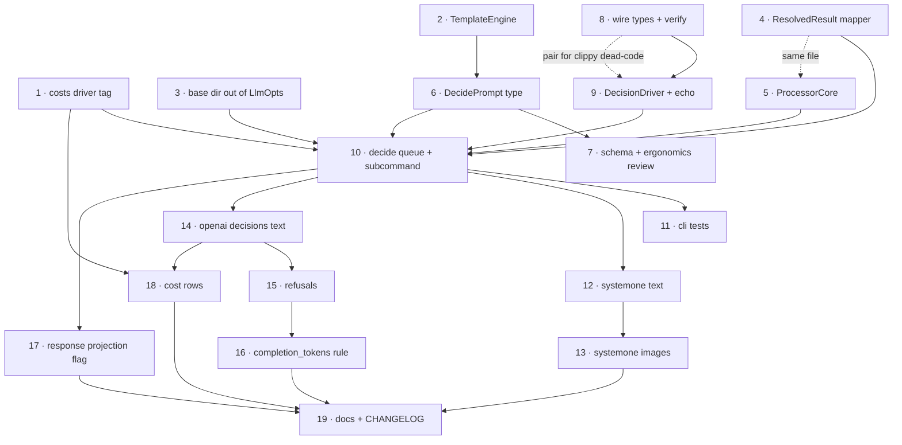

# `decide` Subcommand (Decision / System One Models)

> **Status**: Design agreed. Groundwork (Phase 0), the decision data types, the
> `DecideDriver` trait, the **SystemOne transport (validated against a live llama.cpp
> with Kev-4B)**, `DecideDriverType`, `verify_answers`, and — with items 20 + 10 —
> **the queue and the `decide` subcommand are landed**: `prompt-scaler decide -p
> prompt.json -m MODEL < in.jsonl > out.jsonl` works end to end against a local
> llama.cpp, and `tests/cli.rs` has a live happy-path test plus three
> server-free ones. The Luna transport, image support, the `response` projection
> and the published schema artifacts are still open.
> **NEXT STEPS: item 25** (offline/credential-free test story — `decide`'s queue has
> no CI-runnable coverage today), then 13 (SystemOne images) and 14 (Luna).
> **Echo is on hold pending discussion** — it doesn't map cleanly onto `decide`, and item 11's offline-coverage
> strategy needs revisiting as a result. Where this section and the original draft disagree, §Progress
> wins. Background research lives in `docs/notes/systemone-decision-api.md` (research-stage
> notes — do not edit; wire schemas are there, referenced by section below).

## Progress

What exists in the tree (groundwork row baseline: `ff14cfc`), with the names as implemented:

| What | Where | Notes |
|---|---|---|
| Chat prompt/driver split, type-state prompts | `src/prompts/{mod,chat}.rs`, `src/drivers/llm/`, `src/drivers/ocr/` | `PromptState`/`Template`/`Rendered`; OCR engines moved under `drivers/`. |
| `DecidePrompt` | `src/prompts/decide.rs` | `state: Option<Value>` + `images` + `questions`; questions are not templated. **JSON-only**: no `toml_span::Deserialize` impl (item 21 stays deferred), so `cmd_decide` loads it with the new `async_utils::io::read_json` — `read_json_or_toml` cannot be used, because its `T: toml_span::Deserialize<'static>` bound rejects the type outright. |
| Canonical decision types | `src/drivers/decide/mod.rs` | `DecideRequest` is wire-shaped (consensus /v1/systemone); `DecideResponse` is **canonical, not wire**: carries `token_usage: Option<TokenUsage>`, with the wire `Usage` driver-internal. `Question`/`Answer`. Fields are `pub` (item 20 landed inside 10), so the queue builds requests and reads answers directly. |
| `DecideDriver` trait + `DecideDriverType` | `src/drivers/decide/mod.rs` | `decide()` → `Result<DecideResponse, DriverError>`; model rides inside the request. `DecideDriverType` (`SystemOne` default, `Display`/`ValueEnum`, `create_driver()`) feeds `DriverType::Decide(…)` and is selected by `--driver`. Echo on hold (item 25); `Limits` deferred (§Driver API). |
| `DecideDriverOpts` | `src/drivers/decide/mod.rs` | The `decide` analog of `LlmOpts`, deliberately small: `--driver`, `--decide-timeout`, flattened `DriverOpts`, plus `decide_timeout_duration()`. Naming: `DecideDriverOpts`, not `DecideOpts`, because the subcommand's own clap struct is `cmd::decide::DecideOpts` (chat has the same split: `ChatOpts` + `LlmOpts`). `--driver`/`--model` are unprefixed (conceptually special); other decide flags take a `--decide-` prefix, leaving room for fallback drivers later. |
| `SystemOne` driver | `src/drivers/decide/system_one.rs` | llama.cpp/Jev transport over `reqwest`; driver-internal `SystemOneResponse`/`Usage`; usage normalization incl. the discrepancy `debug!` (item 16's rule, implemented early by agreement). Offline wire-format test passes; live `#[ignore]`d test `test_system_one_live_kev` **passed** against Kev-4B (all three question kinds, legend, probability sums, model echo, `prompt_tokens: 278` + normalized `completion_tokens`). Default server URL is `http://127.0.0.1:8080` (IPv4 literal: llama-server binds `127.0.0.1`; `localhost` may resolve to `::1`). |
| Queue + subcommand | `src/queues/decide.rs`, `src/cmd/decide.rs`, `src/main.rs` | `DecideInput` (verbatim `state` + flattened bindings), `DecideOutput{answers: Option<BTreeMap<String, Answer>>}` (now `Default`), `impl WorkResponse for DecideResponse`, `process_decide_stream` / `create_decide_work_queue` / `run_decide` / `run_decide_inner` on `CommonProcessorState`, `DecideStreamInfo`, `cmd_decide`, `Cmd::Decide`. Prepare failures abort the batch (item 23). `SchemaType` variants wired; `schemas/*.json` + `Justfile` loops not (item 22). |
| Retry→record policy | `WorkOutput::from_resolved_result` (`src/queues/work.rs`) | Generic over a **`WorkResponse` trait**, not over a `(Data, Option<TokenUsage>)` tuple. See §Factoring. |
| Shared processor state | `CommonProcessorState` (`src/queues/processor_state.rs`) | `{rate_limiter, mem_limiter, model_cost}` + `wait_on_rate_limiter()`. No ctor, no `model`/`timeout`/`base_dir`/driver tag. Smaller than the draft's `ProcessorCore` — on purpose. |
| Cost lookup keyed by driver | `ModelKey.driver: Option<DriverType>` (`src/costs.rs`) | `DriverType` is a small shared enum in `drivers/mod.rs` (`Llm(LlmDriverType)`, later `Decide(…)`), parsed with `FromStr` so bad names still error and matching stays case-insensitive; `Display` on `LlmDriverType` supplies the tag. **Not** the draft's `String` tags — same effect, less exposure. |
| Bootstrap behaviour | `DriverOpts::cost_info(DriverType, model)`, `DriverOpts::rate_limiter()` | Where the draft imagined `ProcessorCore::new`, the behaviour went next to the data it reads. |

Naming: **`Decide*` everywhere** — `drivers/decide`, `queues/decide.rs`,
`DecideInput`/`DecideOutput`/`DecidePrompt`, schema titles `DecideInput`/…. So the trait is
`DecideDriver`/`DecideDriverType`, not `DecisionDriver`. Dialect driver types keep
ecosystem spelling: `SystemOne` (file `system_one.rs`), with a driver-internal
`SystemOneResponse` for the wire shape.

**Ordering (revised):** per the §Work Order escape hatch ("if earlier llama.cpp signal
matters: land 1–4, jump to 12"), the `SystemOne` driver came **first**: text-only
`drivers/decide/system_one.rs` against a local llama.cpp, validated by `#[ignore]`d unit
tests inside the driver module (item 20's private fields didn't block a child module, and
in-crate tests sidestep them too). Then 8 (`verify_answers`) → 10 + 20 (queue/CLI
checkpoint), with `pub` visibility landing in the queue commit as planned. Echo is on hold
(item 25) — the offline coverage strategy for 11 is still an open discussion, so today the
queue's only end-to-end coverage is the live `#[ignore]`d test plus the server-free
prepare-failure tests; 21 stays deferred (JSON-only prompts, now via `read_json`) and 22
stays open until the prompt-shape ergonomics review.

## Problem

Decision models (Jev/TypeSafe, llama.cpp `/v1/systemone`, OpenAI `/v1/decisions`) answer
*typed questions* rather than generating text: one forward pass, answers read from
next-token probabilities of single-token labels. They return `choice`/`score`/`bool`
answers with probabilities and a confidence value, accept `state` as string **or** JSON,
and (llama.cpp + Luna) accept images.

They are *similarly* shaped to `chat` but differ in ways that matter:

- Output carries probabilities/confidence, always.
- Schema is a 1-deep object with limited field types — not JSON Schema.
- Every enum option / bool polarity needs its own description; small models degrade
  badly without them.
- Answers are guaranteed-valid by the server; there is nothing to "retry until the
  schema validates". Partial failure (Luna `refusal`) is per-question.

## Decision: new `decide` subcommand, not a mode of `chat`

Reasons, in order of strength:

1. **"Always emit probability & confidence" cannot be expressed in `chat` without
   editing shared types.** `ChatOutput` is `{response: Option<Value>}` and
   `ChatCompletionResponse` is `{response, token_usage}`. Every workaround
   (`_confidence` keys inside `response`, new fields on `ChatCompletionResponse`,
   a side channel) permanently taxes four drivers and the published
   `schemas/ChatOutput.json` + generated bindings.
2. **The question shape is the UI.** It's more accessible than JSON Schema and has
   real traction. Hiding it behind a JSON Schema that a driver decompiles at runtime
   is the opposite of native support: users couldn't copy ecosystem examples or diff
   their config against a server's `/openapi.json`.
3. **A driver is the wrong place for prompt semantics.** A "mapping" chat driver would
   have to *invent* the question list, instructions, and option labels from a schema —
   duplicated per dialect, discovered at runtime. Question derivation belongs at
   prompt-load time, once, with `toml_span` error spans, before any rows are read.
4. Cost/script compatibility (the real argument for reuse) is delivered by
   `WorkOutput<T>` (already shared by `chat` and `ocr`) plus the `response` projection
   below — not by overloading `chat`.

Migration ramp (`ChatPrompt → DecidePrompt`) is **deferred**, one-directional only,
spec'd in §Deferred. It adds no constraints to any type, so deferring it is free.

## Output shape

`WorkOutput<DecideOutput>` — envelope (`status`/`errors`/`estimated_cost`/`token_usage`/
`passthrough_data`) is already the standard format `chat` and `ocr` emit. Data:

```jsonc
"data": {
  // OPTIONAL (`--response-projection`, commit 17): answers projected to a flat object,
  // exactly what an equivalent chat prompt's schema would have produced. External
  // scripts could then read `response` unchanged whether a job ran on a decision model
  // or a chat model. Unsettled — see commit 17.
  "response": { "category": "invoice", "urgent": true, "quality": 2.4 },

  // Rich answers, keyed by question name, canonical across dialects
  // (probabilities are ALWAYS a JSON map — never OpenAI's arrays).
  "answers": {
    "category": { "type": "choice", "choice": "invoice",
                  "confidence": 0.87,                      // server-supplied, opaque
                  "confidence_typesafe": 0.85,             // (n·p_max − 1)/(n − 1)
                  "confidence_entropy": 0.91,              // 1 − H(p)/log n
                  "probabilities": { "invoice": 0.93, "memo": 0.07 } },
    "urgent":   { "type": "bool", "value": true, "probability": 0.91 },
    "quality":  { "type": "score", "score": 2.4, "confidence": 0.60,
                  "probabilities": { "0": 0.02, "1": 0.18, "2": 0.61, "3": 0.19 } }
  }
}
```

- Always emit probabilities *and* confidence. No flag. (Decided.)
- Server confidence passes through untouched (`confidence` — formula is per-dialect and
  not portable). Both canonical formulas are computed client-side from the probability
  vector, which *is* comparable across servers.
- The flat `response` projection is **behind a CLI flag** (unsettled; isolated as commit
  17 so it is one commit to add or drop). It exists for the "route the same job to chat
  or decide across geos" case, whose documented boundary is: **flat scalar answers are
  portable, nesting/arrays are chat-only.**
- Thresholds stay in post-processing (DuckDB), never in the driver. `passthrough_data`
  carries gold labels for later Brier/ECE work.
- Flat normalized CSV (`id, question, kind, choice, score, confidence, …`) is a
  later addition; `OcrOutput::to_flat` is the precedent.
- **As implemented** (`src/queues/decide.rs`): `answers` is `Option<BTreeMap<String,
  Answer>>`, keyed by question name, so the projection and flat-CSV export both remain
  possible, and `DecideOutput` derives `Default` because `WorkOutput::from_resolved_result`
  builds failure data from `Output: Default`. Its element type is `drivers::decide::Answer`
  — the *wire* type — which carries only server-supplied `confidence`, has no `refusal`
  variant, and emits `noul` rather than `bool`. **Item 24 is settled and implemented**: that
  is the intended shape, so the two client-computed formulas (`confidence_typesafe`/
  `confidence_entropy`) have no home and stay out; if they ever come back they belong in the
  §Deferred post-processing bucket, not in `Answer`. The server-resolved response `model` is
  dropped on the way to `DecideOutput`, as in `chat`.

## Prompt shape (to mock up for ergonomics — see §Work Order, commits 6–7)

**JSON only, initially** (decided): `decide` will not support TOML prompts at first, so
item 21 is deferred and the shape below is judged as JSON. Rationale: the JSON question
format is simpler and becoming better-known than full-on `chat` + `json_schema`, so the
prompt doubles as a near-copy of ecosystem examples; `toml_span`'s diagnostics are also
exactly what JSON error reporting lacks, which item 21 would have to rebuild anyway.

**Correction to the draft:** `read_json_or_toml` does *not* "already accept both" for us —
it is bound on `T: DeserializeOwned + toml_span::Deserialize<'static>`, which `DecidePrompt`
does not satisfy, so `read_json_or_toml::<DecidePrompt>` fails to **compile** rather than
failing gracefully on a `.toml` file. Item 10 therefore added `async_utils::io::read_json<T>`
(next to `read_json_or_toml_as_json_value`, with the shared "open + slurp" step factored out)
and `cmd_decide` calls it: a `.toml` decide prompt now gets a plain "TOML is not supported
here" error, which is the behavior item 21 asked for without implementing the toml_span impl.
Covered by `test_decide_rejects_toml_prompt`.

```toml
[state]                      # three modes, explicit (NOT shape-detected from row keys)
text = "..."                 # Handlebars → string
# field = "doc"              # row field passed through verbatim (typed: numbers/nesting preserved)
# "row"                      # state = "row": whole row minus id/skip_processing/passthrough_data
# json = { ... }             # structured state, templated leaves (reuse RenderTemplate for Value)

images = ["{{image-data-url image}}"]   # same syntax as chat; `images_from = "col"` too

[questions.category]
type = "choice"              # user-facing: choice | score | bool (NOT noul/predicate)
instructions = "What kind of document is this?"
[questions.category.options] # HashMap<String,String> ⇒ per-option criteria is
invoice = "A bill for goods or services..."   # structurally impossible to omit
memo    = "An internal memorandum..."

[questions.urgent]
type = "bool"
instructions = "Does this need action within 24 hours?"
true  = "..."
false = "..."
```

State mode wart to resolve: a templated leaf always renders to a **string**, so
`{{amount}}` becomes `"amount": "42"`. Proposal: when a leaf is exactly one mustache
expression, splice the binding's JSON value with its type intact (`{{to-string …}}`
forces text). Shared win — also improves chat's `assistant.json` few-shot examples.

**As implemented** (`src/prompts/decide.rs`) this is *not* the shape above yet, and the mode
table above is **superseded**: `state` is one `Option<Value>`, and there are exactly **two
mutually exclusive ways to supply it** — zero or two sources is an error that stops the whole
run (`queues::decide::assemble_state`). That is all the mode table was really for:

| Mode | Source | Treatment |
|---|---|---|
| **a** | `state` field on the **input record** | sent **verbatim**, no template substitution |
| **b** | `state` in the **prompt** | rendered with the record's bindings (`RenderTemplate for Value`: string leaves only, so the leaf-type splice wart above is still open) |

Custom (flattened) fields are template bindings: in mode b they fill `state` (and `images`),
in mode a only `images`. Bindings are never themselves the state, and unused bindings are not
an error. That was on the table for a moment — "if neither side declares state, use the
bindings object" — and was rejected: implicit state is the kind of magic that costs a reader
twenty minutes six months out. If a richer mode table (`field = "doc"`, an explicit
`state = "row"`) is ever wanted, it becomes a *new* prompt field rather than loosening this rule.

The rest of the trade stands: `questions` is
`BTreeMap<String, drivers::decide::Question>` — prompt type and wire type are the **same**
type, which means the user-facing keyword is `noul`, not `bool`. That trade is now
deliberate (one type, one validation path, prompts read like server payloads and like
ecosystem examples) and has two consequences to keep watching: per-model caps can't live in
`Question` (caps are deferred — see §Driver API), and a dialect that
can't carry criteria (OpenAI `predicate` has no criteria field) must fail loudly rather than
silently drop them — silent small-model regression is still the worst failure mode here.

**Images** (item 13, still open) are a `Vec<String>` of templates rendered with the record's
bindings through the same `templates::TemplateEngine` that `chat` uses, so `image-data-url`
and friends behave identically; the queue renders them and forwards them into
`DecideRequest.images`, treating an empty list as "no images" so text-only requests stay
wire-exact. What item 13 still owes is the `file:` → base64 conversion that chat drivers do
themselves (`ImageFile::from_url(..).load(Base64, mem_limiter)`) plus dialect placement
(`files` vs an `images` alias): `image-data-url` emits a `file:` URL for *late* loading rather
than a data URL, so forwarding is not the same as supporting them. Nothing committed exercises
images, and `MemLimiter::unlimited()` is inherited from `chat` meanwhile (landmine 1).

## Factoring: share the *policies*, not the per-row work fn

| Piece | Verdict | Detail |
|---|---|---|
| `queues/work.rs`, `retry.rs`, `rate_limit.rs`, `timeouts.rs`, `mem_limit.rs`, `costs.rs`, `ui.rs`, `async_utils/io.rs`, `images.rs`, `StreamOpts` | **reuse verbatim, zero edits** | ~1600 lines. None of it mentions `ChatPrompt`. |
| `ChatOutput::from_resolved_result` (`queues/chat.rs`) | **DONE — `WorkOutput::from_resolved_result` + `WorkResponse` trait** (`work.rs`) | Generic over `Response: WorkResponse<Output = T>`; the trait supplies `to_output(self) -> Output` and `token_usage(&self) -> Option<&TokenUsage>`, and failure data comes from `Output: Default` (chat's `empty_for_error()` is gone). Arm semantics preserved, incl. `format!("{err:?}")` and errors ordered retry-then-fatal. Two consequences worth knowing: (a) `to_output` consumes `self` so the payload moves rather than cloning; (b) `token_usage()` returning `Option<&TokenUsage>` **forces** `Usage → TokenUsage` normalization into drivers, which is what the three usage dialects need. Arms remain untested (pre-existing gap). |
| `ProcessorState` bootstrap (`queues/chat.rs`) | **DONE — `CommonProcessorState`** (`queues/processor_state.rs`) | Implemented as `{rate_limiter, mem_limiter, model_cost}` + `wait_on_rate_limiter()`: no ctor, no `model`/`timeout`/`base_dir`/driver tag. Cost lookup + rate-limiter construction became `DriverOpts` methods, since that's where their inputs live. `ChatProcessorState` = `common` + `driver` + `model` + `prompt` + `schema` + `validator` + `llm_opts`; `run_chat` still reaches `llm_opts` for base dir and timeout, so **decide carries its own opts struct for those two values** (accepted, see §Refactorings considered and declined). |
| Handlebars setup (engine + escape fn + helpers + `render_template` ctx) | **DONE — `templates::TemplateEngine`** | One definition, both prompt types use it, so `image-data-url` semantics can't drift. Still built per rendered row; that's pre-existing and cheap next to network latency (see §Refactorings considered and declined). The leaf-type rule above is still unimplemented. |
| `LlmOpts` (`drivers/mod.rs`) | **NOT split (for now) — extract base dir only** | The Transport/Generation split would let `decide` take `TransportOpts` and make meaningless flags unrepresentable, but it is held pending adapter-between-modes decisions and surveying other APIs in this space. Extract only the piece `decide` actually needs — `compute_canonical_base_dir` / `canonical_base_dir()` — as a free function or small struct (commit 3). Behavior, not taxonomy: keeps `decide` independent of `LlmOpts` and keeps the split reversible. |
| `run_chat` / `run_chat_inner` (~200 ln) | **do NOT genericize — write a sibling** | Chat validates a *model-authored blob* against JSON Schema (failure ⇒ **transient** retry); decide *verifies answers against the questions sent* (failure ⇒ **fatal**) plus per-question partials. A shared hook invites the two retry policies to leak into each other. |
| `cmd/chat.rs` / `cmd/ocr.rs` / `cmd/decide.rs` wiring (~60 ln × 3) | **extract *after* `decide` exists** — it now does; still declined | Three real users exist, so `run_stream_pipeline(...)` is finally designable, but it is still a refactor of ~60-line files that all work. Left alone: `decide` copied `chat`'s shape verbatim, so extraction is now a mechanical diff-able move whenever someone wants it. See §Deferred. |
| `ChatInput` vs `DecideInput` | **duplicate (8 ln)** | Two published schema artifacts that will drift independently; aliasing couples public contracts for nothing. Keep parallel by convention + comment. |
| `costs.rs` | **DONE — shared `DriverType` enum, not `String` tags** | `ModelKey.driver: Option<DriverType>`, where `DriverType` (`drivers/mod.rs`) wraps `LlmDriverType` and now also `Decide(DecideDriverType)`. The CSV `driver` column is parsed with `DriverType::from_str`, so unknown names still error at load and matching stays case-insensitive. Keeps the draft's goal (decision drivers never enter the *chat* driver enum) while avoiding a bare string that silently never matches. |
| `WorkOutput::new_failed` | **open — cannot carry `token_usage`/`estimated_cost`** | Both hardcoded to `None`. Luna bills refused records, and every `GivenUp` in `chat` already under-bills. Needs a decision (carry usage on failure, or accept + document under-billing) before item 15. |
| Prepare-failure semantics | **DONE — batch abort, as decided** | `run_chat`'s `render(...)?` escapes the work fn and aborts the whole run (`Err` → `process_blocking` → `write_stream`'s `value?` → `cmd_chat`), while a fatal *driver* error becomes a `failed` record. `run_decide` behaves identically, and the invariants are now enforceable where the types can't reach them: `assemble_state` rejects zero or two state sources. Abort costs no extra control flow (escaping with `?` *is* the abort), so the "keep it simple" tiebreak and the ideal answer coincided. Rationale lives on `run_decide`: a state conflict is a *setup* mistake, and per-record `failed` would hard-fail all 600,000 identically-shaped rows one JSONL record at a time instead of stopping once. Revisit only if a legitimate use case for mixed per-row conflicts appears. |
| `WorkStreamInfo<T>` (`ChatStreamInfo` ≡ `OcrStreamInfo`), `WorkInput::into_parts`, `WorkOutput::new_ok`/`new_skipped` | **deferred, minor** | Three small deduplications in `queues/work.rs`; none blocks decide. Seven hand-built `WorkOutput {…}` literals remain, now concentrated in `work.rs` (2) + `chat.rs` (1, skipped) + the OCR tree (4). |

Net: the hoisting that mattered is done (~120 lines moved into `work.rs` /
`processor_state.rs` / `templates.rs` / `DriverOpts`), and items 10 + 20 consumed most of
the remaining budget: `queues/decide.rs` (~290 ln incl. docs), `cmd/decide.rs` (~100 ln),
`DecideDriverOpts`, `read_json`, and four tests are in. SystemOne is in (tests included);
what's left is Luna ~150, images ~100 plus the `MemLimiter` question (item 13), the
projection flag (17), cost rows (18), the published schema artifacts (22), and prompt-shape
churn from the ergonomics review (7).

## Driver API

One **canonical** `DecideRequest`/`DecideResponse` — **landed in `drivers/decide/mod.rs`**.
The **request** is shaped like the consensus System One wire (`{model, state, images?,
questions: map}`) so `systemone` can serialize it directly. The **response** is canonical,
*not* wire-shaped: it carries `token_usage: Option<TokenUsage>` — our standard token
vocabulary — so each driver deserializes its own dialect response (e.g. `SystemOneResponse`,
holding `Usage`) inside its own module and converts. `images` is a core field with
`skip_serializing_if`, which keeps the text-only path wire-exact. The divergences are
serialization-shaped (map vs. array questions, `noul`/`predicate`, `files` vs.
`input_image`, probability map vs. array, answer-by-name vs. by-id), so one type is honest
and keeps verification in one place. Can't-comply cases ⇒ `DriverError::invalid_input`.

`DecideDriver` — **trait landed in `drivers/decide/mod.rs`**; remainder of item 9 open:

- `async fn decide(&self, request: &DecideRequest) -> Result<DecideResponse, DriverError>`
  — `DriverError` + `IsKnownTransient` is what makes `try_potentially_transient!` and
  `WithTimeout` apply unchanged, exactly as in `run_chat_inner`. The model rides *inside*
  the request (llama.cpp's router routes/auto-loads on `request.model`), unlike
  `LlmDriver::chat_completion`'s separate `model` argument.
- `fmt::Debug + Send + Sync + 'static`, for the same reason `LlmDriver` requires `Debug`.
- Drivers normalize their wire `usage` into `DecideResponse.token_usage` (keeping the raw
  numbers only for the discrepancy `debug!`), because `WorkResponse::token_usage()` hands
  back `Option<&TokenUsage>`. `DecideResponse` therefore has no `Deserialize` impl — it
  is constructed, never parsed; `TokenUsage` stays `Serialize`-only.
- `Display` + `ValueEnum` on `DecideDriverType`, feeding `DriverType::Decide(…)` for cost
  lookups (see §Factoring) — landed; `FromStr` on `DriverType` tries LLM names first, so
  the cost CSV's existing vocabulary can never be shadowed by a decide driver name.

```
src/drivers/decide/mod.rs    # ✅ canonical types + DecideDriver + DecideDriverType
src/drivers/decide/system_one.rs     # ✅ llama.cpp + Jev core + OpenJev-compatible
src/drivers/decide/openai_decisions.rs  # /v1/decisions (Luna)
# echo.rs intentionally absent — echo on hold pending item 25
```

- `state`/`questions` stay wire-clean of image fields (note's dialect advice): `images` is
  a *sibling* field on the canonical request, not an entry inside `state`, and dialects
  place it (`files` vs `images` alias vs `input_image` parts) or reject it. We can skip
  llama.cpp's chat-message `image_url` state form entirely — a small win of not making
  `state` chat-shaped.
- **Per-model caps** (52 options on openjev vs. 255 nominal; score 2–10 vs. 2–64):
  **deferred**. A `Limits` struct on the trait was sketched and dropped — every cap would
  be hand-coded per API/model combo and kept up to date as servers change, to pre-empt
  failures the server already reports clearly. `Question::validate()` enforces generic
  floors at prompt-load time; over-cap requests surface as **non-retryable** errors from
  `decide()`. Revisit only if cap failures bite in practice. `GET /v1/limits`
  auto-negotiation is still not being done (§Deferred).
- Forward-compat serde: keep unknown request/answer fields intact (kunobi's
  `extra()`/`Answer::Unknown`), catch-all for unknown answer variants (beta API).
- `verify_answers(&questions, &answers)` — **landed** (`drivers/decide/mod.rs`, unit
  tested): checks only what parsing can't — same question names (missing/extra), same
  kinds, and choices actually offered ⇒ `invalid_output` **fatal** (deterministic server
  ⇒ endpoint bug, not generation flake; retrying re-hits the same bug).
  **Deliberately no arithmetic checks** (probabilities summing to 1, choice == argmax):
  server-quality questions, not ours to fail records on. The queue still owes Luna
  `refusal` ⇒ first-class per-question outcome carried in `answers[q]`, never a
  record-level status (see §Landmines, items 15/24).
- Router mode: `--model` maps to the per-request `model` field. N questions per request
  (native + cheap); **one row per request** — no multi-state batch endpoint exists, and
  packing N rows into one `state` cross-contaminates on small models. Document "never
  pack rows".
- **Transport notes (implemented with the SystemOne driver):** `reqwest` direct — there
  is no in-house REST abstraction (chat drivers delegate HTTP to SDK crates). `json` and
  `rustls` features are declared explicitly in `Cargo.toml` rather than relying on
  feature unification. `SystemOneDriver` reads `SYSTEM_ONE_API_URL` (default
  `http://127.0.0.1:8080` — IPv4 literal, since `llama-server` binds to `127.0.0.1` but
  `localhost` can resolve to `::1`) and the optional `SYSTEM_ONE_API_KEY` (Bearer — llama.cpp can
  be configured for it, and hosted Jev is a near-term test target), matching the
  inline-`env::var`-at-construction pattern of `native.rs`/`vertex.rs`; `Debug` redacts
  the key. **529 "Overloaded"** (used by Jev and OpenAI, with `Retry-After`) was added
  to the transient `StatusCode` list in `retry.rs`. New shared constructor
  `DriverError::api_status(status, server_message)` classifies non-2xx responses from
  the status; error classification is **read body as text, then parse**: transport
  failures ⇒ transient `api`, a type-mismatched body ⇒ fatal `invalid_output` (the
  server is deterministic; retrying sends the same request to the same broken endpoint).
  `response.model` falls back to the requested model when the server omits it. Live
  validation runs as `#[ignore]`d unit tests in the driver module (house pattern from
  the llama-server tests in `tests/cli.rs`); an offline `test_request_wire_format` test
  pins the request shape.
- Token accounting: these models generate **one token per answer**, even where they don't
  bill for it. So `completion_tokens` = number of answers generated (refusals included),
  computed by us rather than taken from the response — which makes OpenJev's
  `output_tokens = question count` *correct* and llama.cpp's `0` the omission. Log any
  discrepancy at `debug!`. Harmless for cost either way today (decision models carry zero
  output price) and correct for any that ever bill output. Refused records still bill on
  Luna — keep their `token_usage`.

## Landmines / open decisions

1. **MemLimiter multi-image deadlock.** `cmd/chat.rs` passes `MemLimiter::unlimited()`
   with a TODO to pre-acquire permits for all images in a request. Vision `decide` at
   high `--jobs` over PDF pages is precisely that workload, and `cmd_decide` inherits the
   same `unlimited()` workaround (with a comment pointing back at `cmd_chat`) — harmless
   while decide is text-only, i.e. until item 13 actually loads images. Fix properly, or inherit the
   workaround?
2. **Image placement isn't ours to control.** llama.cpp puts `files` *before* the state;
   chat lets authors position images with `image-data-url`. Now that `images` is a sibling
   of `state` on the canonical request (`skip_serializing_if` keeps text-only requests
   wire-exact), placement is dialect-determined. Accept + document, or add
   `image_placement = "before" | "after"`?
3. **Reporting side effects of per-question partials.** `WorkOutputCounters::update`
   (`queues/work.rs`) does `if !is_success { failure_count += 1 } else if !errors.is_empty()
   { non_fatal_error_count += errors.len() }`, and `WorkStatus::Skipped` counts as success.
   So putting refusals in `errors` as well as in `answers[q]` would print
   `⚠️ N non-fatal errors` per refused question, and skip-heavy runs dilute the
   `--allowed-failure-rate` denominator. Consistent with "thresholds and stats in DuckDB",
   but worth a line beside `update` so it isn't rediscovered.

Non-issue, so it doesn't get re-raised: `WorkStatus::Incomplete` is an artifact of
multi-request-per-item work (page-level recovery in OCR) and **cannot arise** on a
one-request-per-item path like `decide`. Per-question refusals live inside `answers[q]`
with the record staying `ok`, so `--allowed-failure-rate` semantics are untouched — which
presupposes item 24, since `Answer` has no `refusal` variant yet.

## Deferred (named, so it stays cheap)

- **`ChatPrompt → DecidePrompt` ramp**: `decide --chat-prompt legacy.toml` and/or
  `prompt-scaler convert-prompt`. One direction only (`DecidePrompt → ChatPrompt` is
  trivial but loses probabilities, so nobody needs it). It **cannot invent criteria
  text** — substitute a placeholder and refuse by default (`--allow-placeholder-criteria`
  to override), because silent small-model quality regression is the worst failure mode
  available. Checkable via the `response` projection.
- `cmd` pipeline extraction; flat CSV answer export; umbrella `run` dispatching on prompt
  shape (only ever *after* two clean subcommands — it makes the output record type
  conditional).
- Preflight (`/v1/limits`, `output_modalities: ["decisions"]`) — skipped: less
  standardized than the core. Just surface 400/501 messages well.
- Per-answer confidence *gates* (judgment's `.at_least()` style) — post-processing.
- Pi's chat-model classification emulation — out of scope per the research note.
- PDF rasterization inside `decide`: compose `ocr` → `decide` on the JSONL for now.

## Work Order

Dependency graph (solid = must land first; dotted = same-file conflict or CI pairing,
not a semantic dependency). Anything not joined by a path can be reordered freely.



> **Note:** the graph below is the original plan and predates implementation — it lacks
> items 20–24 and still uses pre-rename names. The phase tables' `St` column is
> authoritative; `✅` done, `◐` partial, `☐` open.

**Checkpoints:** after **10** the feature is usable and CI-covered with no credentials;
after **12** there is a real llama.cpp path to eval against (`localhost:8080`) — validate
there before adding images in 13, so a bisect can't confuse pipeline bug with wire bug.

**Two ordering principles.** (1) *The unstable artifact goes early, where it has no
consumers:* the prompt format is what most likely churns (it needs human ergonomics
review), so it lands at 6–7 when only `schema` output depends on it — not after a queue,
two drivers and fixtures consume it. (2) *Echo before network:* prove canonical types →
queue → JSONL offline, so each later transport diffs as a pure wire adapter.

### Phase 0 — prepare the ground (pure moves; existing `chat`/`ocr` tests pass unchanged)

| # | Commit | Depends | St | Justification |
|---|---|---|---|---|
| 1 | `costs: key model costs by driver, not the chat driver enum` | — | ✅ | Landed as `ModelKey.driver: Option<DriverType>` + `DriverType::from_str`, not `String` tags: unknown CSV names still error, matching stays case-insensitive. Grows a `Decide(…)` variant with item 9. |
| 2 | `prompt: extract TemplateEngine` | — | ✅ | `templates::TemplateEngine`, one definition for both prompt types. Per-row construction left as-is (see §Refactorings considered and declined). |
| 3 | `prompt: resolve base dir outside LlmOpts` | — | ☐ | Not done: base dir still resolves through `DriverOpts::canonical_base_dir()` reached via `llm_opts`, and timeout is still derived per attempt from `LlmOpts`. decide needs both values and will hold its own opts struct for them, which delivers the independence the draft wanted without touching `LlmOpts`. Revisit only if decide's opts struct starts mirroring `DriverOpts`. |
| 4 | `queues: generalize ResolvedResult → WorkOutput mapping` | — | ✅ | `WorkOutput::from_resolved_result` + `WorkResponse` trait in `work.rs`. Chat's copy is gone; decide gets identical retry reporting by implementing one trait. Arms still lack unit tests (pre-existing). |
| 5 | `queues: extract shared processor state` | (4, same file) | ✅ | Landed as `CommonProcessorState` (3 fields + `wait_on_rate_limiter()`) rather than a `ProcessorCore` with a ctor; the construction helpers went to `DriverOpts::cost_info`/`rate_limiter`. Land-before-10 goal met. |

### Phase 1 — unstable artifacts first

| # | Commit | Depends | St | Justification |
|---|---|---|---|---|
| 6 | `prompt: add DecidePrompt type (not yet wired)` | 2 | ✅ (as redefined) | `state: Option<Value>` + `images` + `questions`, now consumed by the queue. The `text`/`field`/`row`/`json` mode table was **replaced** by the two mutually exclusive state sources (§Prompt shape); the leaf-type splice rule is still unimplemented (string leaves), and the `toml_span::Deserialize` impl stays deferred (item 21). Still the artifact most likely to churn — but it now has consumers, so a shape change is a code change plus fixture edits, not a free edit. |
| 7 | `schema: expose DecidePrompt/DecideInput/DecideOutput` | 6 | ◐ | `SchemaType` variants + titles exist. Missing: `schemas/Decide*.json` (item 22) and **the ergonomics review** — mock 3–4 prompts (whole-row JSON state, image + state, score, bool with polarities) and judge them. Expect a follow-up fix commit; that's why it sits here. `tests/fixtures/decide/{prompt.json,prompt_no_state.json}` are the first two such mocks, written for a JSON prompt with all three question kinds; they were written to be *tested against*, not reviewed, so the review is still owed. |
| 8 | `drivers: canonical decision request/response + answer verification` | (9, CI) | ✅ | Types landed (request wire-shaped; `Answer` probabilities as maps, answers keyed by name). `verify_answers` landed and unit-tested, scoped to relational checks only — names, kinds, offered-choice membership; no probability arithmetic (see §Driver API). The remaining usability fixes moved to item 20. |

New items found while implementing (numbered from 20 to leave 1–19 stable for cross-references):

| # | Commit | Depends | St | Justification |
|---|---|---|---|---|
| 20 | `drivers: make the canonical decide types usable` **(`pub` landed inside 10)** | 8 | ✅ | Both halves done. `DecideResponse` is canonical with `token_usage: Option<TokenUsage>` and the wire `Usage` is driver-internal; `DecideRequest.{model,state,images,questions}`, `DecideResponse.{model,answers,token_usage}`, `DecideInput.{state,template_bindings}` and `DecideOutput.answers` are all `pub`, and the `#![allow(dead_code)]` / `#![expect(dead_code)]` attributes in `drivers/decide/mod.rs`, `queues/decide.rs` and `prompts/decide.rs` are gone. |
| 21 | *(deferred)* `prompts: toml_span::Deserialize for DecidePrompt` | 6 | — | **Deferred by decision: decide ships with JSON prompts only** (see §Prompt shape). Note the draft's premise was wrong: the missing impl means `read_json_or_toml::<DecidePrompt>` *does not compile*, so item 10 added `async_utils::io::read_json` and the desired "JSON only" error is explicit there rather than coming from a deserializer. Still only needed if TOML comes back; `ChatPrompt` (and `Message`) implement `toml_span::Deserialize<'static>` today, which is all `read_json_or_toml` requires. |
| 22 | `schema: emit Decide*.json + update Justfile model loops` | 7 | ☐ | Both model loops (`update-schemas`, `update-pydantic-models`) still list only the five pre-decide models, so the published artifacts silently omit decide. |
| 23 | `decide: prepare-failure semantics + input invariants` | 10 | ✅ | **Batch abort — implemented.** No separate commit: `run_decide`'s prepare step (`prompt.render` + `assemble_state`) returns `Err`, which escapes the work fn and stops the run; documented on `run_decide` (why abort beats 600,000 identically-shaped `failed` records) and on `DecideInput` (the two-source rule). Zero or two state sources are both covered by server-free tests. |
| 24 | *(decided)* `decide: output answer type (computed confidences, refusal)` | 8, 10 | ✅ (decided) | **Ship the wire-format `Answer`, `noul` naming included.** Deliberate policy: expose new functionality as close to upstream conventions as possible — they're semi-standardizing at remarkable speed, and our output should read like a server's. Client-computed confidences (`confidence_typesafe`/`confidence_entropy`) are out; Luna `refusal` (item 15), when it lands, should follow the same rule — model it on the wire type, don't wrap. |

### Phase 2 — offline end-to-end

| # | Commit | Depends | St | Justification |
|---|---|---|---|---|
| 9 | `drivers: decide driver trait + driver type` | 8, 20 | ◐ | `DecideDriver` trait landed (`decide()` → `Result<DecideResponse, DriverError>`, `Debug + Send + Sync + 'static`), plus `DecideDriverType` (`SystemOne` default, `ValueEnum`, `Display` → `system_one`, `create_driver()`) and the `DriverType::Decide(…)` variant with LLM-name-first `FromStr` (round-trip test added). Per-driver `Limits` dropped (see §Driver API): `Question::validate()` keeps the static floor (choice ≥2, score 2–10); per-model caps (52 vs 255 options; score 2–64) surface as non-retryable runtime errors. **Echo split out of this item and put on hold** — see item 25. |
| 10 | `queues: decide work queue + decide subcommand` **(with 20 + a `tests/cli.rs` integration test)** | 1,4,5,6,9 | ✅ | **Landed, and the feature is usable.** Item 20's `pub` visibility landed here and the stale `#![allow(dead_code)]`s are gone; state assembly follows the two-source rule (§Prompt shape: prompt `state` rendered via `DecidePrompt::render`, input `state` verbatim, zero/two ⇒ error); then request → `wait_on_rate_limiter()` + `with_timeout` → driver → `verify_answers` (fatal via `try_fatal!`, which is what retired that macro's `#[allow(unused_macros)]`) → `DecideOutput` via `from_resolved_result`, on `CommonProcessorState` + `DEFAULT_JITTER`. Prepare failures abort the batch (item 23) and answers are wire-format `Answer` (item 24). New: `read_json` (§Prompt shape), `DecideDriverOpts`, `cmd_decide`, `Cmd::Decide`, and `SYSTEM_ONE_API_URL`/`_API_KEY` in the root `--help`. Tests: `test_decide_questions_llama` (`#[ignore]`d, Kev-4B, all three question kinds, asserts `completion_tokens == question count`) plus three **server-free** ones — `test_decide_state_from_both_sources_fails`, `test_decide_state_from_neither_source_fails`, `test_decide_rejects_toml_prompt` — which fail during prepare, before any request, so they do run in CI. **Checkpoint passed.** |
| 11 | `tests: cli coverage for decide` | 10, 25 | ◐ | Partially absorbed into 10: happy path with all three question kinds and `state` from the prompt (live, `#[ignore]`d), and three server-free prepare/validation tests that do run in CI. Remaining: verify-failure ⇒ fatal, skip/passthrough, mode a (state from the row) end to end, `--decide-timeout`. **Accepted CI gap** unchanged: with echo on hold (item 25) there is no credential-free *successful* `decide` path, so the success arm can't run in CI until 25 resolves an offline mechanism. |
| 25 | `decide: offline test story (echo reconsidered)` | — | ☐ | Echo was planned as the credential-free end-to-end path (`test_chat_echo_driver` analog), but **the user judged that echo doesn't work as well for `decide`, for reasons to be discussed** — recorded here so the gap is explicit rather than silently inherited. Whatever replaces it must still let CI cover the queue with no server, since the live Kev test stays `#[ignore]`d. Candidates to weigh when the reasoning is on the table: a fake/in-process HTTP server; record-replay of real llama.cpp responses; a `DecideDriver` test impl that derives answers structurally from the questions; leaning on the `#[ignore]`d live test plus unit tests. |

### Phase 3 — transports, one variable at a time

| # | Commit | Depends | St | Justification |
|---|---|---|---|---|
| 12 | `drivers: SystemOne transport (text-only)` | ~~10~~ **moved first** (§Progress) | ✅ | Implemented in `system_one.rs` (see §Progress and Transport notes). Done: `SystemOneDriver` (+env vars, key-redacting `Debug`), `SystemOneResponse`/`Usage`, error classification incl. new `DriverError::api_status` and 529-as-transient, usage normalization, offline wire test. **Checkpoint passed**: `test_system_one_live_kev` ran green against `ggml-org/Kev-4B-GGUF:Q4_K_M` on a live llama.cpp — canonical types need no changes before the queue is built. Stays `#[ignore]`d for CI. |
| ~~12a~~ | *(merged into 12)* | | ✅ | Token-normalization rule pulled forward from 16 by agreement; 16 keeps only the Luna side. | Cheap by design: the canonical *request* already is the wire shape, so it's mostly reqwest + a driver-internal `SystemOneResponse`/`Usage` deserialize + usage normalization with the discrepancy `debug!`, plus `SYSTEM_ONE_API_URL`/`SYSTEM_ONE_API_KEY` and `#[ignore]`d live tests against a local llama.cpp (`localhost:8080`). Self-hosted and free. **Checkpoint**: validate the wire here before item 10 exists, so the queue lands against a proven transport. |
| 13 | `drivers: SystemOne image support (files/data URLs)` | 12 | ☐ | `DecideRequest.images` exists; this is dialect placement (`files` vs `images` alias) plus the unstandardized axis, and where `MemLimiter` multi-image acquisition bites (landmine 1). |
| 14 | `drivers: openai decisions transport (Luna)` | 10 | ☐ | Second dialect, text-only first; exercises the canonical type's dialect-neutrality by *converting* rather than serializing. Must refuse loudly when prompt criteria can't be expressed (`predicate` has no criteria field). |
| 15 | `drivers: handle per-question refusals as first-class outcomes` | 14, 24 | ☐ | A *semantic* addition (partial answers; refused records still bill ⇒ depends on the `new_failed`/usage decision in §Factoring), not a transport detail. |
| 16 | `drivers: normalize completion_tokens to answers generated` | 15 (both dialects) | ◐ | Rule implemented in the SystemOne driver already (answer count + discrepancy `debug!`); what remains is applying it to Luna (refusals included) once item 14 lands. |

### Phase 4 — surface & cleanup

| # | Commit | Depends | St | Justification |
|---|---|---|---|---|
| 17 | `decide: optional chat-shaped response projection (flagged)` | 10 | ☐ | Deliberately late and isolated: least-settled decision, so removal is one commit. `answers` being keyed by name keeps this mechanical. |
| 18 | `costs: pricing rows for decision models` | 1,14 | ☐ | Luna is input-only pricing; local models need no row (unknown ⇒ no estimate, which is honest). Needs the `DriverType::Decide` variant from item 9 to key on. |
| 19 | `docs + CHANGELOG` | 13,16,17,18 | ☐ | Also record in docs: the user-facing question keyword is `noul` (consequence of sharing one `Question` type prompt↔wire), and `images` placement is dialect-determined. |

Optional later: `cmd: extract shared stream pipeline harness` (three real users exist);
flat CSV answer export; the `ChatPrompt → DecidePrompt` ramp (§Deferred).

### Orderings considered and rejected

- **Vertical slice first** (llama.cpp `decide` working, refactor after). Better when the
  *internal* shape is what's uncertain; here it's settled and the *external* wire is what
  is uncertain — and Phase 0 is cheap pure moves, so deferring them costs writing the
  retry→record policy twice and re-reviewing chat regressions twice. If earlier llama.cpp
  signal matters: land 1–4, jump to 12, then 6–10.
- **Drivers before prompt type.** Rejected: prompt churn dominates expected cost, and
  drivers consume the canonical wire types, not the prompt type — nothing gained.
- **Dialects bundled with the queue.** Rejected: bundles a new CLI surface with two
  unproven transports, so a bisect can't separate pipeline bug from wire bug.
- **Extractions interleaved into feature commits.** Rejected as a rule: breaks the
  "pure move ⇒ existing tests are the proof" property that makes refactors cheap.
  Exception already made: 8+9 pairing, forced by `clippy -D warnings` on dead code.

### Refactorings considered and declined

Recorded so they don't get re-raised as oversights.

- **A shared "attempt" wrapper and a generic `retry_record`.** Hoisting chat's
  permit → timeout → `try_potentially_transient!` block and its
  jitter → `retry_with_backoff` → `from_resolved_result` block would remove ~20 lines of
  near-duplication, but both sit exactly where the queues' real differences live:
  permit-per-*attempt* relative to the timeout, and what happens when the pre-retry prepare
  step fails. `wait_on_rate_limiter()` is the piece that was extracted; that's the seam.
  Reopen only if the two copies demonstrably drift.
- **`ProcessorCore` with a constructor, model, timeout, base dir and driver tag.**
  `CommonProcessorState` is deliberately the three data fields; construction helpers live on
  `DriverOpts`. Each queue owns its own opts bag, which keeps `decide` out of `LlmOpts`
  without inventing a `TransportOpts` taxonomy for one user.
- **Minor perf items, all pre-existing and cheap against network latency:** a fresh
  Handlebars registry per rendered row; `ModelCostDatabase::new()` re-parsing the CSV on
  each `cost_info()` call (one call per queue today; a trap only if it ever becomes
  per-row); chat's inline `ExponentialJitter` literal duplicating `retry::DEFAULT_JITTER`.
- **Pre-existing test gaps inherited, not fixed:** the `Recovered`/`GivenUp`/
  `Unrecoverable` arms of the retry→record policy have no unit tests (unreachable from
  integration tests), and `skip_processing` coverage is a live-model test only.

## Testing notes

- `cargo check` → `cargo test` after each step; `cargo test -- --include-ignored` for
  live-model tests only on request; `just check` before committing.
- `decide` coverage today: `test_decide_questions_llama` (`#[ignore]`d, needs a decision
  model — `ggml-org/Kev-4B-GGUF:Q4_K_M`, which reports `output_modalities:
  ["decisions"]`; **not** the `LLAMA_SERVER_MODEL` the chat tests use) and three
  server-free tests (state from both sources, state from neither, TOML prompt rejected)
  that pass by failing during prepare, before any request is sent. Fixtures live in
  `tests/fixtures/decide/`. Set `SYSTEM_ONE_API_URL` if your server isn't on 8080;
  `localhost` is fine on this machine.
- Offline coverage for `chat` rides the echo driver pattern (`test_chat_echo_driver` in
  `tests/cli.rs`), but echo is **on hold for `decide`** (item 25) — the credential-free
  coverage mechanism must come out of that discussion before item 11 can land.
- Live llama.cpp examples/configs say `localhost:8080` in anything committed — hostnames
  for this machine's local infrastructure stay out of the repo.
- `RUST_LOG=prompt_scaler=debug,warn` when debugging a run.
